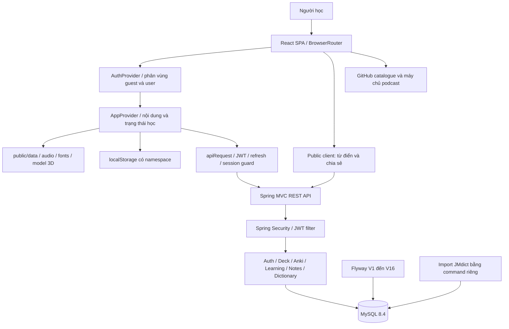
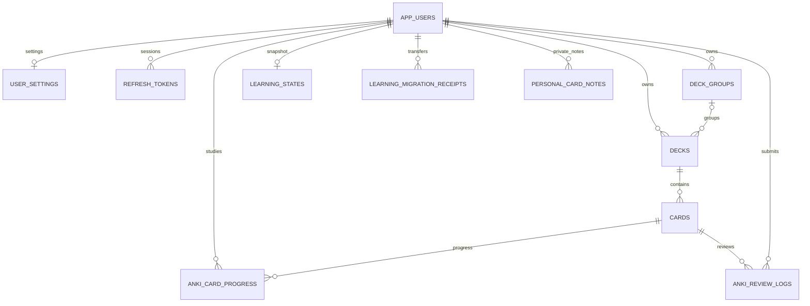
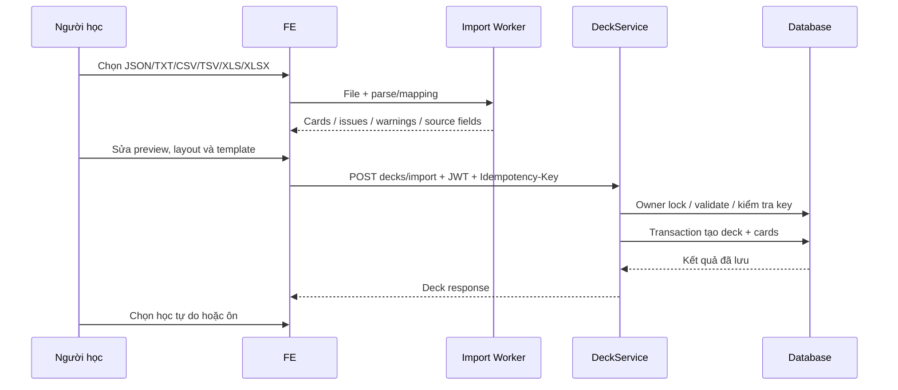

# Kiến trúc chi tiết hệ thống SỔ NHẬT — Backend và Frontend

> Ngày kiểm tra: **15/10/2026**, cập nhật theo mã nguồn ngày **17/10/2026**. Workspace: `D:\project\NHAT`.
> Tài liệu mô tả mã nguồn đang có tại thời điểm kiểm tra. Các mục “đề xuất” và “cần xác minh” không phải chức năng đã triển khai.
> Phạm vi: kiến trúc ứng dụng, module, trách nhiệm từng file nguồn, API, lưu trữ, dữ liệu, luồng nghiệp vụ, bảo mật, triển khai và kết quả kiểm tra. Không kiểm toán hạ tầng production hoặc tài khoản dịch vụ bên ngoài.

## Mục lục

1. [Tổng quan và công nghệ](#1-tổng-quan-và-công-nghệ)
2. [Sơ đồ kiến trúc](#2-sơ-đồ-kiến-trúc)
   - [Cây thư mục tổng thể](#21-cây-thư-mục-tổng-thể)
   - [Cây thư mục FE theo lớp](#22-cây-thư-mục-fe-theo-lớp)
   - [Cây thư mục BE theo lớp](#23-cây-thư-mục-be-theo-lớp)
   - [Chiều phụ thuộc giữa các layer](#24-chiều-phụ-thuộc-giữa-các-layer)
3. [Chức năng và phân chia FE–BE](#3-chức-năng-và-phân-chia-febe)
4. [Kiến trúc frontend](#4-kiến-trúc-frontend)
5. [Kiến trúc backend](#5-kiến-trúc-backend)
6. [Cơ sở dữ liệu và migration](#6-cơ-sở-dữ-liệu-và-migration)
7. [Danh mục API](#7-danh-mục-api)
8. [Luồng nghiệp vụ chi tiết](#8-luồng-nghiệp-vụ-chi-tiết)
9. [Bảo mật và tính nhất quán](#9-bảo-mật-và-tính-nhất-quán)
10. [Cấu hình, chạy và triển khai](#10-cấu-hình-chạy-và-triển-khai)
11. [Kết quả kiểm tra và điểm cần xử lý](#11-kết-quả-kiểm-tra-và-điểm-cần-xử-lý)
12. [Hướng dẫn bảo trì](#12-hướng-dẫn-bảo-trì)
13. [Danh mục từng file FE](#13-danh-mục-từng-file-fe)
14. [Danh mục từng file BE](#14-danh-mục-từng-file-be)
15. [Phạm vi sử dụng tài liệu](#15-phạm-vi-sử-dụng-tài-liệu)

## 1. Tổng quan và công nghệ

SỔ NHẬT là ứng dụng học tiếng Nhật, gồm thư viện từ vựng/Kanji/ngữ pháp, học thẻ tự do, ôn ngắt quãng, quiz, nghe, từ điển, bộ thẻ cá nhân, nhóm bộ thẻ, chia sẻ và ghi chú cá nhân.

Hệ thống có **hai repository Git độc lập**, `FE/N3/.git` và `BE/japanese-server/.git`. Thư mục `NHAT` không phải Git repository. Bản làm việc chung đặt ở gốc workspace; một bản `KIEN_TRUC_HE_THONG.md` giống nhau được lưu tại gốc mỗi repository FE và BE để theo dõi bằng Git. Khi cập nhật tài liệu cần đồng bộ hai bản. Các đường dẫn `FE/N3/...` và `BE/japanese-server/...` trong tài liệu được tính từ gốc workspace `NHAT`, kể cả khi đọc bản trong một repository.

| Thành phần | Công nghệ khai báo trong mã nguồn | Vai trò |
|---|---|---|
| FE | React `^19.2.8`, TypeScript `~6.0.2` | SPA, UI và logic học tại trình duyệt |
| Build FE | Vite `^8.2.0`, plugin React, Tailwind `^4.3.3` | Dev server, biên dịch và đóng gói |
| Điều hướng | React Router DOM `^7.18.2` | URL, layout, trang chia sẻ |
| UI | Lucide, Framer Motion, clsx, tailwind-merge, CVA | Icon, animation và phối hợp class |
| Tìm kiếm nội bộ | Fuse.js | Tìm trong thư viện học có sẵn |
| Bộ lập lịch FE | `ts-fsrs` **5.4.2** | FSRS cho thẻ tích hợp và xem trước khoảng ôn |
| Import bảng | SheetJS `xlsx` **0.20.3** từ tarball khai báo | Đọc Excel ở FE |
| Nhân vật 3D | Three.js `^0.186.1`, GLTF/Draco | Mèo trên dashboard |
| BE | Java **21**, Spring Boot **4.1.1**, Maven Wrapper | REST API dạng monolith theo module |
| Persistence | Spring Data JPA, Hibernate, MySQL Connector/J | Mapping entity, truy vấn và transaction |
| Schema | Flyway, `flyway-mysql` | 16 migration V1–V16 |
| Bộ lập lịch BE | `io.github.open-spaced-repetition:fsrs:1.0.0` | FSRS cho thẻ cá nhân |
| Xác thực | Spring Security, JWT HMAC tự triển khai, BCrypt | Access token, refresh token và kiểm soát truy cập |
| API docs | Springdoc **3.1.1** | OpenAPI và Swagger UI |
| Database local | MySQL **8.4** trong Compose | Dữ liệu tài khoản, thẻ, từ điển và tiến độ |
| Kiểm thử | Node test runner, Playwright, Spring Boot Test, H2 | Unit, browser và integration |

Các phiên bản có `^`/`~` là khoảng phiên bản khai báo, không phải khẳng định phiên bản của mọi máy triển khai. `package-lock.json` chốt dependency FE cho cài đặt tái lập.

## 2. Sơ đồ kiến trúc



**Nguyên tắc phân lớp:** UI gọi hooks hoặc hàm nghiệp vụ FE; API client chuyển dữ liệu qua REST; controller BE nhận request và lấy user từ security context; service xử lý quyền sở hữu, transaction và nghiệp vụ; repository/EntityManager truy cập DB. Một số module nhỏ dùng EntityManager trực tiếp; `UserSettingsController` cũng chứa nghiệp vụ cập nhật settings, nên BE chưa tách lớp service đồng đều ở tất cả module.

Không có microservice, message broker, Redis hoặc WebSocket trong kiến trúc ứng dụng hiện tại. Cache từ điển nằm trong bộ nhớ tiến trình BE.

### 2.1. Cây thư mục tổng thể

```text
NHAT/
├── KIEN_TRUC_HE_THONG.md       # Tài liệu kiến trúc dùng chung FE và BE
├── FE/
│   └── N3/                    # Repository frontend độc lập
│       ├── src/               # Mã ứng dụng: UI, hooks, nghiệp vụ, API và storage
│       ├── public/            # Tài nguyên phục vụ trực tiếp cho browser
│       │   ├── data/          # JSON thư viện, podcast và mẫu import
│       │   ├── audio/jlpt/    # Audio bài luyện nghe
│       │   ├── fonts/         # Font local và license
│       │   └── models/        # Model mèo 3D
│       ├── tests/             # Unit, browser, integration và benchmark
│       ├── scripts/           # Cập nhật dữ liệu, tạo audio/model/note ID
│       ├── deploy/            # Nginx: serve SPA, proxy API và headers
│       ├── .github/workflows/ # Workflow cập nhật catalogue nghe
│       ├── docs/              # Tài liệu tính năng, kiểm thử và thiết kế
│       ├── artifacts/         # Ảnh kiểm tra và asset làm việc
│       ├── package.json       # Dependency và lệnh FE
│       ├── vite.config.ts     # Build/dev server, alias và proxy
│       ├── tsconfig*.json     # Cấu hình TypeScript
│       ├── vercel.json        # SPA rewrite trên Vercel
│       ├── dist/              # Output build, sinh tự động
│       └── node_modules/      # Dependency cài đặt, sinh tự động
└── BE/
    └── japanese-server/       # Repository backend độc lập
        ├── src/
        │   ├── main/
        │   │   ├── java/com/japaneselearning/japanese_learning_api/
        │   │   │              # HTTP, security, nghiệp vụ và persistence
        │   │   └── resources/
        │   │       ├── application.yml        # Cấu hình runtime chính
        │   │       ├── application.properties # Application name
        │   │       └── db/migration/          # Schema Flyway V1–V16
        │   └── test/
        │       ├── java/      # Unit/integration test theo module
        │       └── resources/ # Fixture JMdict
        ├── database/          # SQL khởi tạo database/user local
        ├── scripts/           # Import snapshot từ điển
        ├── docs/              # Tài liệu từ điển và ghi chú cá nhân
        ├── .mvn/              # Cấu hình Maven Wrapper
        ├── pom.xml            # Dependency/build Java
        ├── mvnw, mvnw.cmd      # Lệnh Maven Unix/Windows
        ├── compose.yml        # MySQL local
        ├── Dockerfile         # Build/run API bằng JDK/JRE 21
        ├── .dictionary-data/  # Dữ liệu vận hành từ điển local
        └── target/            # Classes, JAR, test reports sinh tự động
```

Cây tổng thể tập trung thư mục chức năng và file cấu hình chính; không liệt kê `.git`, secret hoặc từng file dependency/build output. Hai cây nguồn bên dưới liệt kê đầy đủ file trong `FE/N3/src` và package Java chính của BE.

### 2.2. Cây thư mục FE theo lớp

FE tổ chức theo **loại trách nhiệm ở cấp src** và **tính năng bên trong components**. Ký hiệu lớp trong chú thích là cách đọc kiến trúc hiện tại, không phải thư mục mới được tạo.

| Lớp | Vị trí thực tế | Trách nhiệm |
|---|---|---|
| F0 — Khởi tạo/điều phối | `main.tsx`, `App.tsx` | Mount ứng dụng, providers và router |
| F1 — Giao diện | `components/`, `index.css` | Trang, layout, dialog, editor và renderer |
| F2 — Trạng thái/điều phối nghiệp vụ | `hooks/`, một số hooks trong components | Context, lifecycle, sync, timer, auth và trạng thái UI |
| F3 — Quy tắc nghiệp vụ | Các file thuần trong `lib/` | Card mapping, FSRS, queue, import, format, quiz và metrics |
| F4 — Truy cập dữ liệu | API/storage/data adapters trong `lib/` | HTTP, localStorage/sessionStorage, tải JSON và worker |
| F5 — Hợp đồng dữ liệu | `types/` và types cạnh module | Kiểu domain/UI/request/response |

**Lưu ý:** F3 và F4 cùng nằm trong `lib/`; FE chưa tách thư mục `domain/` và `infrastructure/`. Components có thể gọi trực tiếp API/helper, nên đây là các lớp trách nhiệm, không phải kiến trúc dependency nghiêm ngặt đã được cưỡng chế.

```text
FE/N3/src/
├── components/  # F1 — Giao diện theo tính năng
│   ├── auth/  # Tài khoản, trạng thái phiên và chuyển dữ liệu
│   │   ├── AccountLearningStatus.tsx  # Hiển thị trạng thái lưu/đồng bộ dữ liệu tài khoản
│   │   ├── auth.css  # Style màn hình và dialog auth
│   │   ├── AuthDialog.tsx  # Hộp thoại auth tại ngữ cảnh và thông báo phiên
│   │   ├── AuthPage.tsx  # Màn hình chọn guest/login/register trước vào không gian học
│   │   ├── GuestCardNotesTransfer.tsx  # Chuyển ghi chú guest sang account theo luồng riêng
│   │   └── LearningSyncPanel.tsx  # UI sync/retry/conflict, backup và chuyển guest/legacy có xác nhận
│   ├── bookmarks/  # Nội dung đã lưu
│   │   └── BookmarksPage.tsx  # Danh sách nội dung tích hợp đã lưu
│   ├── dashboard/  # Tổng quan và mèo 3D
│   │   ├── catAppearance.ts  # Điều chỉnh vật liệu/màu và appearance mèo
│   │   ├── CatCompanion.tsx  # Tải/render mèo GLB, animation, tương tác và cleanup tài nguyên WebGL
│   │   ├── catConfig.ts  # Cấu hình model/animation/placement của mèo
│   │   ├── companionPolicy.ts  # Quy tắc hành vi/hiển thị companion và tôn trọng điều kiện UI
│   │   └── Dashboard.tsx  # Tổng quan hôm nay, việc cần học, thống kê và lối vào học
│   ├── dictionary/  # Tra từ và thêm từ vào bộ
│   │   ├── AddDictionaryCardDialog.tsx  # Chọn written/reading/sense, deck, preview thẻ và lưu idempotent
│   │   ├── dictionary.css  # Style dictionary và dialog thêm từ
│   │   └── DictionaryPage.tsx  # Tìm từ, phân trang cursor, entry detail và trạng thái dataset
│   ├── flashcard/  # Bộ thẻ, import, học, nhóm, note và chia sẻ
│   │   ├── CardFields.tsx  # Trường nhập/sửa dữ liệu card dùng chung
│   │   ├── CardPresentation.tsx  # Renderer hai mặt và template/reading/examples/note của thẻ
│   │   ├── DeckCard.tsx  # Card danh mục bộ, summary, metric và CTA
│   │   ├── deckCard.css  # Style card bộ thẻ
│   │   ├── DeckGrid.tsx  # Bố cục responsive danh sách bộ
│   │   ├── deckGroups.css  # Style nhóm bộ thẻ
│   │   ├── DeckGroups.tsx  # UI quản lý group, mở/đổi tên/giải tán/sắp xếp và chuyển bộ
│   │   ├── DeckShareDialog.tsx  # Tạo/copy/revoke link, trạng thái và consent personal notes
│   │   ├── DeckWidgetCustomize.tsx  # Bảng tùy chỉnh widget nhóm (kích thước, màu, độ mờ), không modal, xem trước trực tiếp
│   │   ├── FlashcardPage.tsx  # FlashcardPage/AnkiPage mỏng bọc UnifiedDeckPage (free/scheduled) và helper speakJapanese
│   │   ├── FuriganaText.tsx  # Hiển thị ruby/reading từ segment furigana
│   │   ├── ImportedDecks.tsx  # Quản lý bộ cá nhân, import/tạo/sửa, phân trang cards, mở học và nhóm
│   │   ├── ImportGuide.tsx  # Hướng dẫn định dạng import, prompt và file mẫu
│   │   ├── ImportPreviewEditor.tsx  # Preview/mapping source fields, bố trí mặt và style trước lưu
│   │   ├── personalCardNote.css  # Style note editor và trạng thái
│   │   ├── PersonalCardNote.tsx  # UI đọc/sửa note riêng, status, retry/conflict và draft
│   │   ├── richCardContent.css  # Style rich text trong card
│   │   ├── RichCardContent.tsx  # Render các node rich text đã lọc thành React
│   │   ├── SharedDeckContent.tsx  # Hiển thị phần nội dung thẻ preview chia sẻ
│   │   ├── SharedDeckPage.tsx  # Trang public xem preview deck và nhận bản sao
│   │   ├── SharedGroupPage.tsx  # Trang public nhóm chia sẻ, danh sách deck và nhận nhóm
│   │   ├── SharedPageLayout.tsx  # Khung giao diện trang chia sẻ độc lập không gian học
│   │   ├── sharing.css  # Style trang/dialog chia sẻ
│   │   ├── StudySession.tsx  # Phiên học chung: lật thẻ, rating, queue, enqueue lượt ôn vào outbox, hoàn tác (Backspace), audio, ghi metric và sửa thẻ
│   │   ├── studySession.css  # Style phiên học
│   │   ├── StudyClock.tsx  # Đồng hồ thời gian học hiển thị, tạm dừng khi ẩn tab hoặc mở hộp thoại
│   │   ├── StudySetupSheet.tsx  # Chọn bài/options trước phiên học tự do
│   │   ├── UnifiedDeckPage.tsx  # Hợp nhất danh mục tích hợp/cá nhân/saved cho mode free hoặc scheduled
│   │   ├── useDeckGroupSizes.ts  # Resize chiều rộng/cao khung nhóm bằng pointer/phím, giới hạn kích thước, lưu local và hủy thao tác
│   │   └── useSharedSave.ts  # Điều phối lưu bản sao, yêu cầu auth và kết quả alreadySaved
│   ├── grammar/  # Thư viện ngữ pháp
│   │   └── GrammarPage.tsx  # Thư viện mẫu ngữ pháp, cấu trúc/cách dùng/ví dụ và bookmark
│   ├── kanji/  # Thư viện Kanji
│   │   └── KanjiPage.tsx  # Thư viện Kanji, reading/Hán Việt/từ liên quan và bookmark
│   ├── layout/  # Khung ứng dụng và menu
│   │   ├── BottomNav.tsx  # Điều hướng chính trên mobile
│   │   ├── MainLayout.tsx  # Khung ứng dụng, nội dung và điều hướng desktop/mobile
│   │   ├── navigationItems.ts  # Cấu hình mục menu dùng chung
│   │   ├── NotFoundPage.tsx  # Trang URL không hợp lệ
│   │   └── Sidebar.tsx  # Navigation sidebar desktop, trạng thái thu gọn và tài khoản
│   ├── library/  # Layout thư viện
│   │   └── LibraryLayout.tsx  # Khung/tab thư viện và Outlet route con
│   ├── listening/  # Podcast và bài luyện nghe
│   │   ├── examData.ts  # Đề, lựa chọn, đáp án, transcript/dịch và tham chiếu audio bài luyện
│   │   ├── JlptListeningPractice.tsx  # Phiên nghe trắc nghiệm, nộp bài, giải thích/dịch và lưu điểm tốt nhất
│   │   └── ListeningPage.tsx  # Catalogue podcast, filter, stream, trạng thái local và tab JLPT
│   ├── progress/  # Thống kê tiến độ
│   │   └── ProgressPage.tsx  # Thống kê hoạt động/streak/SRS và dự báo ôn
│   ├── quiz/  # Trắc nghiệm
│   │   └── QuizPage.tsx  # Chọn quiz, trả lời, chấm và hiển thị giải thích/kết quả
│   ├── search/  # Tìm nội dung tích hợp
│   │   └── SearchModal.tsx  # Tìm nhanh nội dung tích hợp và điều hướng tới kết quả
│   ├── settings/  # Cài đặt
│   │   └── SettingsPage.tsx  # Cấu hình giao diện, audio/furigana/FSRS, dữ liệu và trạng thái đồng bộ
│   ├── ui/  # Thành phần UI dùng chung
│   │   ├── AppDialog.tsx  # Dialog chung cho tương tác ứng dụng
│   │   ├── AppLoading.tsx  # Loading dùng chung, hỗ trợ toàn màn hình
│   │   ├── OverflowMenu.tsx  # Menu tác vụ phụ/overflow
│   │   └── StudyUI.tsx  # Các primitive UI phục vụ học và quản lý bộ
│   └── vocabulary/  # Thư viện từ vựng
│       └── VocabularyPage.tsx  # Thư viện từ vựng, lọc/tìm/xem nội dung và bookmark
├── hooks/  # F2 — Context, trạng thái, lifecycle và đồng bộ
│   ├── useActiveElapsedMinutes.ts  # Đo thời gian hoạt động, timer phiên Anki và format thời gian
│   ├── useApp.tsx  # App context, tải dữ liệu tích hợp, bookmarks/SRS/settings và kết nối sync/notes
│   ├── useAuth.tsx  # Auth context, login/register/logout/guest, restore, session generation và draft khi cần auth
│   ├── useCardAudio.ts  # Phát âm tự động qua browser speech synthesis và hủy khi đổi/unmount
│   ├── useCardNotes.ts  # Tạo notes store có/không API; lifecycle, retry online/focus/60 giây
│   ├── useLearningSync.ts  # Tải/sửa snapshot có revision, dirty queue, debounce, retry và conflict backup
│   ├── useDeckWidgetStyles.ts  # Đọc/ghi style widget nhóm vào storage, chuẩn hóa và dọn id không còn
│   ├── useReviewOutbox.ts  # Nối outbox lượt ôn với API (batch built-in, review thẻ cá nhân, undo) và vòng gửi lại
│   ├── useReviewTiming.ts  # Đo thời gian nhớ/quyết định theo thẻ, tạm dừng khi ẩn tab hoặc mất focus
│   └── useSettingsSync.ts  # GET settings, local-first update, pending PATCH tuần tự và tránh response cũ ghi đè
├── lib/  # F3/F4 — Nghiệp vụ, API, storage và adapters
│   ├── dictionary/  # Client API và draft của từ điển
│   │   ├── api.ts  # Dictionary types, public GET, romaji kana, picker/add/create và chọn form/reading/sense hợp lệ
│   │   └── draft.ts  # Lưu/khôi phục/validate bản nháp thêm từ trong sessionStorage
│   ├── ankiImport.ts  # Schema import, parser JSON/text/Excel, mapping/layout nguồn, normalize template, validate và worker entry
│   ├── ankiStorage.ts  # Adapter tương thích deck import sang API; tải cả bộ/progress, ghi/sắp xếp/move, không phải local DB
│   ├── api.ts  # Base URL, ApiError, token/session migration, authenticated request, refresh single-flight, auth/settings/CRUD/review helpers
│   ├── cardAppearance.ts  # Tạo draft appearance, phát hiện style riêng hai mặt và sao chép style một mặt sang mặt kia
│   ├── cardFormatting.ts  # Parse rich text có allowlist tag/style, lọc nội dung nguy hiểm
│   ├── cardNotes.ts  # Note key, local/draft/dirty store, save/retry/conflict và export có consent
│   ├── cards.ts  # CardView/DeckSummary và adapter vocabulary/Kanji/grammar/import
│   ├── data.ts  # Fetch/normalize/cache vocabulary N3/N4, Kanji N2/N3/N4 và grammar N2/N3/N4
│   ├── deckApi.ts  # API phân trang deck/card, metadata, group, import idempotent; chuyển card/import body
│   ├── deckCatalog.ts  # Xây danh mục bộ tích hợp theo level, bộ saved và summary
│   ├── deckSchedule.ts  # Xây scheduled queue/count theo due, trạng thái, thẻ mới/ngày
│   ├── deckSharing.ts  # Kiểu và client preview/copy/status/revoke deck/group, tách public request khỏi auth
│   ├── deckWidgets.ts  # Kiểu, màu và chuẩn hóa style widget nhóm bộ thẻ
│   ├── fsrsProgress.ts  # Adapter ts-fsrs, chuyển legacy, tính lịch tích hợp và preview interval
│   ├── furigana.ts  # Parse/chuẩn hóa furigana, reading và bracket syntax; trả segment/warning
│   ├── grammarData.ts  # Chuẩn hóa ngữ pháp, ví dụ, reading và thông tin cách dùng từ schema nguồn
│   ├── guestSession.ts  # Đọc/ghi cờ guest của browser session
│   ├── import.worker.ts  # Chạy parse file ngoài main thread và trả preview/error qua postMessage
│   ├── importSummary.ts  # Gom lỗi import, số liệu tóm tắt và danh sách thẻ mẫu giới hạn
│   ├── learningSync.ts  # Kiểu snapshot/report, API learning và stable migration key SHA-256
│   ├── liveReviewQueue.ts  # Quản lý ready/waiting queue theo due time để thẻ quay lại đúng hạn
│   ├── loadStudyPages.ts  # Gom các trang học, tải tiếp tối đa ba trang đồng thời và giữ thứ tự
│   ├── n5Decks.ts  # Tải và chuyển JSON N5 thành các bộ/thẻ dùng chung
│   ├── navigation.ts  # Page ID ↔ canonical route, chuyển route cũ và resolve trang khởi đầu
│   ├── quiz.ts  # Sinh quiz vocabulary/Kanji, chọn đáp án nhiễu và shuffle
│   ├── reviewOutbox.ts  # Outbox bền vững cho lượt ôn: enqueue, claim, gửi theo lô, hoàn tác, projectedReview
│   ├── reviewSnapshot.ts  # Gộp 3 chiều (local/base/remote) sau khi server xác nhận lượt ôn
│   ├── reviewTiming.ts  # Bộ đếm thời gian ôn (recall/decision), hợp lệ khi không ẩn tab hay đổi giờ
│   ├── srs.ts  # Facade tạo/ôn SRS, due queue, forecast/distribution và format ngày/khoảng ôn
│   ├── storage.ts  # Learning storage có namespace, settings/SRS/bookmark/studyDays/resume/theme/reset và thông báo lỗi quota
│   ├── studyMetrics.ts  # Phân biệt số lượt xem học tự do với số lượt ôn/chỉ số kết quả
│   ├── studyResume.ts  # Key tiếp tục theo bộ, tìm vị trí từ card ID đã lưu và fallback an toàn
│   ├── studySetup.ts  # Options chọn bài, build queue học tự do và encode/decode URL setup
│   └── utils.ts  # Hàm `cn` kết hợp clsx và tailwind-merge để ghép class
├── types/  # F5 — Hợp đồng dữ liệu dùng chung
│   └── index.ts  # Hợp đồng domain/UI: nội dung học, SRS, settings, StudyDay, quiz và navigation
├── App.tsx  # Auth gate, providers, route, lazy-load page, public dictionary/share và loading/error
├── index.css  # Tailwind, token thiết kế, theme, font và style chung
└── main.tsx  # Tạo React root, StrictMode, BrowserRouter và nạp CSS toàn cục
```

### 2.3. Cây thư mục BE theo lớp

BE tổ chức **theo module nghiệp vụ kết hợp layer dùng chung**: `deck`, `auth`, `anki`… đặt controller/service/DTO gần nhau; `model` và `repository` dùng chung. Không có thư mục `controller/` hoặc `service/` tổng cho toàn hệ thống.

| Lớp | Vị trí thực tế | Trách nhiệm |
|---|---|---|
| B0 — Khởi tạo/cấu hình | Application, `config/`, `security/` | Boot, filter chain, JWT, CORS và OpenAPI |
| B1 — HTTP/API | `*Controller.java` trong module | Nhận HTTP, validate DTO, lấy current user và trả response |
| B2 — Nghiệp vụ | `*Service.java`, scheduler/parser/cache hỗ trợ | Ownership, transaction, revision, idempotency và thuật toán |
| B3 — Truy cập dữ liệu | `repository/`, repository notes, EntityManager trong service | Query, aggregate, persistence và khóa DB |
| B4 — Mô hình lưu trữ | `model/`, entities trong learning/notes/dictionary | Mapping bảng/cột/quan hệ/lifecycle |
| B5 — Hợp đồng và xử lý chung | `*Dtos.java`, record cạnh service, `common/` | Request/response, constraints và error mapping |

**Ngoại lệ hiện có:** `UserSettingsController` gọi repository và xử lý settings trực tiếp; `DictionaryController` dùng EntityManager cho deck picker; learning/dictionary dùng EntityManager ở service. Không mô tả chúng như đã đi qua một service/repository riêng khi mã nguồn chưa có lớp đó.

```text
BE/japanese-server/src/main/java/com/japaneselearning/japanese_learning_api/
├── anki/  # B1/B2/B5 — API ôn, FSRS và DTO
│   ├── AnkiController.java  # Endpoint due queue, progress cả bộ và review
│   ├── AnkiDtos.java  # DTO queue/progress/rating/review request/response
│   ├── AnkiScheduler.java  # Adapter Java FSRS, settings retention/steps, state và interval/lapses
│   ├── ReviewSchedulingTime.java  # Chọn thời điểm tính lịch: ratedAt hợp lệ của client, nếu không dùng giờ server nhận
│   ├── ReviewTiming.java  # Kiểm tra và chuẩn hóa dữ liệu thời gian ôn (recall/decision, hợp lệ)
│   └── AnkiService.java  # Queue due/new allowance, khóa review, receipt clientReviewId, lưu progress/log
├── auth/  # B1/B2/B5 — API tài khoản, tokens và DTO
│   ├── AuthController.java  # HTTP register/login/refresh/logout/me
│   ├── AuthDtos.java  # Request/response auth và Bean Validation
│   └── AuthService.java  # Chuẩn hóa email, BCrypt, tạo user/settings, cấp/rotate/revoke token
├── common/  # B5 — Exception và HTTP error mapping
│   ├── ApiException.java  # Exception nghiệp vụ có HTTP status/message/code và factory
│   └── ApiExceptionHandler.java  # Map lỗi nghiệp vụ, validation và optimistic locking thành JSON
├── config/  # B0 — Cấu hình OpenAPI
│   └── OpenApiConfig.java  # Mô tả OpenAPI và bearer authentication cho Swagger
├── deck/  # B1/B2/B5 — Bộ/thẻ/nhóm, import và chia sẻ
│   ├── DeckController.java  # Endpoint deck/card CRUD, metadata, pages, reorder/move và import
│   ├── DeckDtos.java  # DTO deck/card/page/progress và giới hạn input
│   ├── DeckGroupController.java  # HTTP nhóm và move deck vào/ra nhóm
│   ├── DeckGroupService.java  # Tạo/rename/dissolve/reorder group, kiểm tra version/quyền và summary
│   ├── DeckGroupShareController.java  # Link nhóm, preview nhóm/deck trong nhóm và copy nhóm
│   ├── DeckGroupShareService.java  # Lọc thành viên IMPORT, metadata paging, hạn mức và copy nhóm riêng
│   ├── DeckService.java  # Owner/card locking, transaction, soft delete, count/order, import hash/key, filter/paging và summary
│   ├── DeckShareController.java  # Link owner, public preview deck, authenticated copy
│   ├── DeckShareService.java  # Chỉ share IMPORT, token/revoke/consent, nửa đầu preview, idempotent copy
│   ├── ImportSizeFilter.java  # Đọc/giới hạn raw body 20 MiB cho POST create/import, trả 413
│   └── SharedDeckContent.java  # Lock owner có thứ tự, kiểm hạn mức, copy card/template/provenance và note có consent
├── dictionary/  # B1/B2/B4/B5 — Tra cứu, import, cache, card write và entities
│   ├── DictionaryCardService.java  # Thêm từ/tạo deck idempotent, validate selection/owner, identity và provenance
│   ├── DictionaryCatalog.java  # Entity con trỏ dataset hoạt động
│   ├── DictionaryController.java  # Public search/word/sources, authenticated add/create và deck picker nhẹ
│   ├── DictionaryData.java  # Kiểu dữ liệu nội bộ/DTO dictionary, sense/reading/source payload
│   ├── DictionaryDataset.java  # Entity metadata dataset/version/status/count/time/source
│   ├── DictionaryEntry.java  # Entity entry payload theo dataset/key
│   ├── DictionaryForm.java  # Entity cách viết/cách đọc chuẩn hóa để exact/prefix search
│   ├── DictionaryImportCommand.java  # Command import dataset trong tiến trình không web
│   ├── DictionaryImportService.java  # Import batch, validation, trạng thái dataset, activate/rollback version
│   ├── DictionaryNormalizer.java  # Chuẩn hóa Unicode/kana và token tìm nghĩa
│   ├── DictionarySearchCache.java  # TTL/bounded cache, coalescing load và giới hạn số key/bộ nhớ
│   ├── DictionaryService.java  # Search/ranking, cursor/version, word detail, source readiness và lỗi dataset
│   ├── DictionaryToken.java  # Entity token nghĩa để tìm kiếm
│   ├── DictionaryWriteRequest.java  # Entity request hash/result cho replay write
│   ├── JapaneseDeinflector.java  # Sinh ứng viên từ dạng chia, giới hạn lớp biến đổi và POS
│   └── JmdictReader.java  # Đọc XML JMdict thành entry/forms/readings/senses; bảo vệ external entity
├── learning/  # B1/B2/B4/B5 — Đồng bộ snapshot và chuyển guest
│   ├── BuiltInReviewLog.java  # Entity log lượt ôn thẻ tích hợp: request id, before/result card, telemetry, undoneAt
│   ├── BuiltInSchedulerAdapter.java  # Chuyển SrsCard của snapshot ↔ AnkiCardProgress để dùng chung AnkiScheduler
│   ├── LearningController.java  # GET/PUT learning, review đơn/lô thẻ tích hợp, undo và POST guest transfer
│   ├── LearningDtos.java  # DTO bookmark/SRS/StudyDay/snapshot/transfer và constraints
│   ├── LearningReceipt.java  # Entity receipt migration theo user/request key/fingerprint
│   ├── LearningService.java  # Owner lock, revision check, snapshot JSON, review idempotent (đơn/lô, khóa theo expectedRepetitions), undo, validate và hợp nhất guest một lần
│   └── LearningState.java  # Entity một snapshot/revision trên user
├── model/  # B4 — Entity nghiệp vụ và enums
│   ├── AnkiCardProgress.java  # Entity progress thẻ cá nhân gồm FSRS và review counters
│   ├── AnkiReviewLog.java  # Entity log review, clientReviewId và result replay
│   ├── Card.java  # Entity thẻ: deck/nội dung/kind/order/extraData/source/dictionary/soft delete
│   ├── Deck.java  # Entity deck: owner/source/template/group/count/soft delete/share/version
│   ├── DeckGroup.java  # Entity nhóm, order/version/share/import key
│   ├── DomainTypes.java  # Enums user role/status, nguồn/visibility, card kind, Anki state/rating
│   ├── RefreshToken.java  # Refresh hash/device/expiry/revoke và quan hệ user
│   ├── User.java  # Account profile, status/role/timezone, audit/version và password hash
│   └── UserSettings.java  # Settings một-một user, mặc định và lifecycle timestamp
├── notes/  # B1/B2/B3/B4 — Ghi chú riêng và persistence
│   ├── PersonalCardNote.java  # Entity nội dung note riêng, owner/key/revision/timestamp
│   ├── PersonalCardNoteController.java  # GET no-store và PUT note theo key/current owner
│   ├── PersonalCardNoteRepository.java  # Lookup note theo owner/key và batch keys khi copy
│   └── PersonalCardNoteService.java  # Validate key/text, key cá nhân SHA-256, owner lock, revision/idempotent text/tombstone
├── repository/  # B3 — Query/JPA repositories dùng chung
│   ├── AnkiCardProgressRepository.java  # User/card progress, due queue, count thẻ mới hôm nay và queries tổng hợp
│   ├── AnkiReviewLogRepository.java  # Lookup user/clientReviewId cho idempotent review và lưu log
│   ├── CardRepository.java  # Active card queries/page/search/count, due/new support, share copy và lock/move
│   ├── DeckGroupRepository.java  # Owner groups/order/share/import-copy lookup và lock
│   ├── DeckRepository.java  # Owner/active deck lookup, page/group/order/share/import-copy và locking queries
│   ├── RefreshTokenRepository.java  # Find refresh token hash và CRUD
│   ├── UserRepository.java  # Find email/user, tồn tại email và query lock owner
│   └── UserSettingsRepository.java  # Persistence settings theo user UUID
├── security/  # B0 — Security filter, JWT, CORS và current user
│   ├── CurrentUser.java  # Lấy UUID principal hoặc trả lỗi thiếu phiên
│   ├── JwtAuthenticationFilter.java  # Đọc Bearer token, parse và đặt authentication vào SecurityContext
│   ├── JwtService.java  # Tạo/verify JWT HMAC, claim subject/role/expiry và TTL access
│   └── SecurityConfig.java  # Filter chain stateless, public allowlist, CORS, BCrypt cost 12
├── user/  # B1/B5 — API settings và DTO; controller gọi repository trực tiếp
│   ├── UserSettingsController.java  # GET/PATCH settings và kiểm tra learning steps/retention
│   └── UserSettingsDtos.java  # Settings request/response và validation các tùy chọn
└── JapaneseLearningApiApplication.java  # Spring Boot entrypoint/component scan
```

### 2.4. Chiều phụ thuộc giữa các layer

Mũi tên biểu thị **lời gọi/phụ thuộc mã nguồn**, không phải chiều dữ liệu trả về. Response đi ngược về nơi gọi. Các type/DTO được nhiều lớp sử dụng nên đặt cạnh sơ đồ, không hiểu là một bước thực thi cuối cùng.

```text
FRONTEND — luồng phổ biến

main.tsx → App.tsx
              │
              ▼
      components/ (F1: UI)
          │          │
          ▼          └──────────────┐
      hooks/ (F2: state/sync)       │  UI có gọi helper/API trực tiếp
          │                        │
          ▼                        ▼
      lib/ nghiệp vụ (F3) ←→ lib/ adapters (F4)
          │                        ├── HTTP → Backend
          │                        ├── localStorage/sessionStorage
          │                        └── fetch JSON / Web Worker
          └──────────────┬─────────┘
                         └── dùng types/ và type cạnh module (F5)

BACKEND — luồng phổ biến

HTTP → SecurityConfig/JwtAuthenticationFilter (B0)
                         │
                         ▼
                 *Controller (B1)
                         │
                         ▼
                   *Service (B2)
                         │
                  ┌──────┴───────┐
                  ▼              ▼
            Repository       EntityManager (B3)
                  └──────┬───────┘
                         ▼
                   JPA Entity (B4) → MySQL

DTO/Validation (B5): dùng tại ranh giới Controller ↔ Service.
ApiExceptionHandler: chuyển exception từ request flow thành HTTP error.
Flyway: quản lý schema khi khởi động; không phải bước chạy mỗi request.
```

Ví dụ xuyên suốt **ôn một thẻ cá nhân**:

```text
StudySession.tsx                         [FE/F1: nhận rating từ người học]
  → lib/api.ts::reviewCard               [FE/F4: gửi JWT + clientReviewId]
  → POST /api/v1/anki/cards/{id}/reviews  [ranh giới HTTP]
  → JwtAuthenticationFilter             [BE/B0: xác thực bearer token]
  → AnkiController.review               [BE/B1: DTO và current user]
  → AnkiService.review                  [BE/B2: quyền, lock, chống ghi trùng]
      ├── CardRepository                [BE/B3: khóa/lấy thẻ thuộc owner]
      ├── AnkiScheduler                 [BE/B2: tính FSRS]
      ├── AnkiCardProgressRepository    [BE/B3: lưu lịch mới]
      └── AnkiReviewLogRepository       [BE/B3: log và replay result]
  → AnkiCardProgress / AnkiReviewLog     [BE/B4: entities]
  → MySQL                               [lưu bền vững trong transaction]
  → response progress → StudySession    [FE cập nhật UI/queue]
```

Khi tìm một chức năng, đọc cây theo **tính năng → controller/component → service/hook → adapter/repository → model/storage**. Mục 13 và 14 giữ bảng tra cứu từng file; cây ở đây giúp nhìn vị trí và quan hệ lớp trước khi đi vào chi tiết.

## 3. Chức năng và phân chia FE–BE

| Chức năng | FE chịu trách nhiệm | BE chịu trách nhiệm | Nơi lưu chính |
|---|---|---|---|
| Tài khoản | Form, khôi phục phiên, trạng thái guest/auth, xử lý response cũ | Đăng ký/đăng nhập, BCrypt, cấp/đổi/thu hồi token | `app_users`, `refresh_tokens`; token ở browser |
| Thư viện tích hợp | Tải JSON, chuẩn hóa schema, lọc và hiển thị | Không có API CMS quản lý thư viện tích hợp | `FE/N3/public/data` |
| Học tự do | Chọn bộ/bài, lật thẻ, phát âm, tiếp tục vị trí | Cấp dữ liệu nếu là bộ cá nhân | Local vị trí học; thẻ cá nhân ở DB |
| Ôn tích hợp | Chấm lạc quan bằng FSRS, hàng đợi, outbox lượt ôn bền vững, hoàn tác | Tính FSRS chính thức, lưu log lượt ôn và snapshot có revision | Browser + `learning_states`, `builtin_review_logs` |
| Ôn bộ cá nhân | Lấy queue, gửi rating, `clientReviewId` và dữ liệu thời gian qua outbox, hoàn tác | Tính FSRS chính thức, lưu progress/review log | `anki_card_progress`, `anki_review_logs` |
| Import | Đọc file trong worker, mapping, preview, định dạng | Kiểm tra DTO, hạn mức, quyền và tạo atomically | `decks`, `cards` |
| Quản lý bộ/thẻ | CRUD UI, lọc, phân trang, template | CRUD, move/reorder, soft delete, owner lock | `decks`, `cards` |
| Nhóm bộ thẻ | Tạo/đổi tên/di chuyển/sắp xếp nhóm | Version, quyền sở hữu, giải tán nhóm | `deck_groups`, `decks.group_id` |
| Chia sẻ | Link, preview công khai, nhận bản sao sau đăng nhập | Token chia sẻ, giới hạn preview, copy độc lập | Deck/group gốc + bản sao riêng |
| Từ điển | Tra cứu, romaji→kana, chọn cách đọc/nghĩa, thêm thẻ | Tìm JMdict, cursor, cache, chống thêm trùng | Các bảng `dictionary_*`, `cards` |
| Ghi chú cá nhân | Editor, bản nháp, dirty queue và xử lý conflict | Lưu riêng theo owner/key, revision/tombstone | Local + `personal_card_notes` |
| Bookmark/tiến độ ngày | Toggle, tổng hợp UI, forecast/streak | Lưu và chuyển dữ liệu guest một lần | Local + learning snapshot |
| Quiz | Sinh câu hỏi/đáp án nhiễu, chấm bài, phản hồi | Không có quiz service riêng | Logic FE và thống kê hoạt động |
| Podcast | Danh mục, stream, đánh dấu/ghi chú | Không có podcast service riêng | JSON metadata; tiến độ local |
| Nghe JLPT dạng luyện tập | Phát bài audio, chấm trắc nghiệm, dịch và điểm tốt nhất | Không có chấm thi BE riêng | Audio/đề tĩnh, điểm local |
| Settings | Theme, chữ, furigana từng mặt, audio, FSRS và pending patch | Validate và lưu settings theo user | Local + `user_settings` |
| Mèo dashboard | Render GLB, hành vi/animation và reduced motion | Không có service pet | Asset tĩnh + trạng thái browser |

**Giới hạn nội dung:** N5 có đường tải bộ thẻ riêng qua `n5Decks.ts`. Từ vựng thư viện chính dùng N3/N4; Kanji và ngữ pháp chính dùng N2/N3/N4. Không suy ra mọi cấp JLPT đều có đầy đủ mọi loại nội dung chỉ từ tên dự án N3.

## 4. Kiến trúc frontend

### 4.1. Khởi tạo và providers

`src/main.tsx` tạo React root, bật StrictMode và BrowserRouter. `App.tsx` đặt `AuthProvider` ở ngoài; `AuthGate` quyết định trang công khai, màn hình tài khoản hoặc không gian học. `AppProvider` dùng `key={sessionKey}` để tạo lại cây trạng thái khi phiên thay đổi.

`useAuth.tsx` quản lý ba mode: `unauthenticated`, `guest`, `authenticated`. Cờ guest dùng sessionStorage; dữ liệu học guest dùng localStorage. Khi đăng nhập hoặc đổi tài khoản, không tự gộp toàn bộ guest data; UI chuyển dữ liệu riêng để người dùng xác nhận.

`useApp.tsx` tập trung dữ liệu từ vựng/Kanji/ngữ pháp/N5, settings, bookmarks, SRS, modal tìm kiếm và navigation target. Hook nối ba kênh persistence riêng: learning snapshot, settings patch, personal card notes. FE dùng React Context và hooks; không có Redux/Zustand trong dependencies.

### 4.2. Bản đồ URL thực tế

| URL | Component/ý nghĩa | Điều kiện |
|---|---|---|
| `/` | `RootRedirect` đọc trang trước qua `resolveInitialPath` | Không gian học |
| `/today` | `Dashboard` — việc học hôm nay | Guest hoặc account |
| `/dictionary/*` | `DictionaryPage` — tìm từ, xem chi tiết | Công khai; ghi thẻ cần account |
| `/library` | Redirect sang `/library/vocabulary` | Guest hoặc account |
| `/library/vocabulary` | `VocabularyPage` | Guest hoặc account |
| `/library/grammar` | `GrammarPage` | Guest hoặc account |
| `/library/kanji` | `KanjiPage` | Guest hoặc account |
| `/library/listening` | `ListeningPage`, gồm podcast và luyện JLPT | Guest hoặc account |
| `/decks` | `FlashcardPage` → `UnifiedDeckPage` mode free | Bộ tích hợp cho guest; lưu bộ cá nhân cần account |
| `/review` | `AnkiPage` → `UnifiedDeckPage` mode scheduled | Tương tự, theo lịch ôn |
| `/quiz` | `QuizPage` | Guest hoặc account |
| `/progress` | `ProgressPage` | Guest hoặc account |
| `/saved` | `BookmarksPage` | Guest hoặc account |
| `/settings` | `SettingsPage` | Guest hoặc account |
| `/shared/:token` | `SharedDeckPage` | Preview công khai; copy cần account |
| `/shared/groups/:token` | `SharedGroupPage` | Preview công khai; copy cần account |
| URL khác | `NotFoundPage` | Trong router ứng dụng |

Đăng nhập không có route `/login` độc lập trong `App.tsx`: `AuthPage`/`AuthDialog` được chọn qua auth state. Phần lớn trang học lazy-load qua Suspense. Từ điển được phép mở độc lập, không đợi toàn bộ thư viện học tải xong.

`SRSPage.tsx` và phần phiên học cũ trong `FlashcardPage.tsx` (VocabFlashcardSession, GrammarFlashcardSession và các control đi kèm) đã được xóa vì không còn nơi nào import. Đường ôn hiện tại đi qua `/review` và `UnifiedDeckPage` → `StudySession`.

### 4.3. Mô hình dữ liệu dùng chung

`types/index.ts` khai báo vocabulary, kanji, grammar, SRS, bookmark, StudyDay, settings và các kiểu UI. `data.ts`/`grammarData.ts` chuẩn hóa JSON cũ mới thành dạng thống nhất. `cards.ts` đổi nội dung tích hợp và imported card thành **CardView** để `StudySession` và renderer dùng chung.

Các loại thẻ: `VOCABULARY`, `KANJI`, `GRAMMAR`, `GENERAL`. Nguồn thẻ UI: `BUILT_IN`, `MANUAL`, `IMPORT`; deck tổng hợp bookmark còn có `SAVED`. Chữ hoa/thường giữa API và FE được chuyển tại adapter. `extraData` chứa trường mở rộng: Hán Việt, ví dụ, reading mặt sau, furigana và layout field import. Trường nguồn từ điển đáng tin cậy được BE quản lý riêng, không lấy extraData người dùng làm căn cứ chống trùng.

### 4.4. Hiển thị thẻ

`CardPresentation` kết hợp nội dung, mẫu hai mặt, furigana, ví dụ và ghi chú. `RichCardContent`/`cardFormatting.ts` phân tích nội dung có định dạng sang phần tử React với tag/style được cho phép; không hiển thị HTML import nguyên xi bằng cơ chế chèn HTML trực tiếp. Tất cả nơi hiển thị nội dung nhập cần tái sử dụng renderer này.

Template cho phép font, cỡ chữ 12–72 px, căn lề, đậm/nghiêng và theme riêng mỗi mặt. Furigana nhận reading có sẵn hoặc `漢字[かな]`; parser không có chức năng đoán reading bằng AI. TTS dùng `speechSynthesis` của browser, phụ thuộc giọng tiếng Nhật đã cài trên thiết bị.

### 4.5. Storage và phạm vi đồng bộ

| Nhóm dữ liệu | Key/phạm vi | Đồng bộ |
|---|---|---|
| Access/refresh token, session identity | `auth:access_token`, `auth:refresh_token`, `auth:session_id` | Cục bộ browser, BE quản lý token hash |
| Dữ liệu guest | `guest:<key>` | Chỉ thiết bị; có chuyển thủ công |
| Dữ liệu user | `user:<UUID>:<key>` | Tùy loại dữ liệu dưới đây |
| Bookmark, SRS tích hợp, studyDays | `n3_bookmarks`, `srs_cards_*`, `n3_study_days` trong namespace | Snapshot learning |
| Revision/dirty/base/backup | `learning_revision`, `learning_dirty`, `learning_base`, `learning_local_backup`, `learning_conflict_backup` | Metadata đồng bộ tại browser |
| Settings | `n3_settings`, `settings_pending` | GET/PATCH settings khi có account |
| Ghi chú riêng | `card_notes_v1`, `card_note_drafts_v1` | API notes riêng khi có account |
| Podcast | `nhat-listening-v1` trong namespace | **Không đồng bộ thiết bị** |
| Điểm luyện nghe | `nhat-jlpt-listening-scores-v1` trong namespace | **Không đồng bộ thiết bị** |
| Vị trí học/menu | Last page/deck/index/resume/sidebar | Cục bộ; không nằm trong learning snapshot |
| Bản nháp từ điển | sessionStorage qua `dictionary/draft.ts` | Cục bộ phiên browser |

`createLearningStorage(scope)` bắt giữ scope ngay khi tạo instance, tránh callback cũ ghi vào tài khoản mới. Các response API còn được kiểm tra `sessionIdentity`. Lỗi quota storage phát event `learning-storage-error`.

Đây là kiến trúc có lưu local và retry một số dữ liệu, **chưa phải PWA offline hoàn chỉnh**: không có service worker bảo đảm lần đầu mở ứng dụng, asset hoặc toàn bộ API đều dùng được khi mất mạng.

### 4.6. Hiệu năng FE

- Route lazy-load giảm tải ban đầu; SheetJS và Three.js vẫn tạo các chunk lớn khi build.
- Import file chạy trong Web Worker khi browser hỗ trợ; hủy tác vụ bằng AbortSignal.
- Bộ cá nhân dùng danh sách deck 20 mục/trang, thẻ thường 50 mục/trang. Học tự do có thể gom nhiều trang qua `loadStudyPages`: tải trang đầu lấy tổng, sau đó tối đa ba request trang đồng thời, giữ thứ tự.
- `loadStudyPages` giới hạn số request song song nhưng cuối cùng vẫn giữ toàn bộ thẻ đã tải trong bộ nhớ; không đồng nghĩa với virtualized streaming.
- Ôn dùng hàng đợi đến hạn và giới hạn thẻ mới. Thẻ trả lời AGAIN rời queue sẵn sàng rồi trở lại khi đến hạn.
- Dữ liệu thư viện có cache module trong `data.ts`; thay JSON thường cần tải lại trang/build phù hợp.

## 5. Kiến trúc backend

Package gốc: `com.japaneselearning.japanese_learning_api`, entrypoint `JapaneseLearningApiApplication`.

| Module | Trách nhiệm | Phụ thuộc/lưu trữ chính |
|---|---|---|
| `auth` | Đăng ký/đăng nhập, refresh rotation, logout, current user | User, UserSettings, RefreshToken, JwtService |
| `security` | Filter chain, CORS, BCrypt, ký/đọc JWT, lấy user UUID | Spring Security, HMAC |
| `deck` | Bộ/thẻ/nhóm, metadata, trang thẻ, import, move/reorder, chia sẻ/copy | Deck/Card/Group repositories, EntityManager, personal notes |
| `anki` | Queue, progress và review idempotent, adapter FSRS | Progress/review/card/deck/user/settings |
| `learning` | Snapshot tích hợp, revision và chuyển guest | LearningState/LearningReceipt qua EntityManager |
| `notes` | Ghi chú cá nhân theo key, version và tombstone | PersonalCardNoteRepository, owner lock |
| `dictionary` | Import JMdict, catalogue version, tìm từ, cache, tạo thẻ | Dictionary entities, EntityManager, DeckService |
| `user` | Đọc/PATCH settings, validate retention/learning steps | UserSettingsRepository |
| `model`, `repository` | Domain entities, query/lifecycle và khóa DB | JPA/Hibernate |
| `common`, `config` | API error thống nhất, OpenAPI | MVC advice và Springdoc |

### 5.1. Request và transaction

Request có token hợp lệ được `JwtAuthenticationFilter` đưa vào SecurityContext với principal UUID và authority `ROLE_<role>`. Controller dùng `CurrentUser.id(auth)`. Service tiếp tục lọc dữ liệu theo owner; UUID đối tượng do client gửi không tự chứng minh quyền truy cập.

`DeckService` quản lý soft delete qua `deletedAt`; các truy vấn hoạt động phải lọc deck/card chưa xóa. Sửa nội dung thẻ giữ UUID, do đó giữ lịch review. Move thẻ giữ identity của thẻ, đồng thời cập nhật vị trí/count và kiểm tra trùng identity từ điển.

Các mutation thư viện/từ điển có owner lock để tuần tự hóa ghi trong cùng tài khoản. Sharing khóa các owner theo thứ tự UUID để giảm nguy cơ deadlock khi copy qua lại. `AnkiService.review` khóa card trước kiểm tra `clientReviewId`. Không giả định mọi endpoint đều dùng cùng một loại khóa: learning và notes còn có protocol revision riêng.

### 5.2. FSRS và hai nguồn lịch ôn

**Thẻ tích hợp:** FE vẫn dùng `ts-fsrs` để chấm lạc quan và hiển thị khoảng lịch, rồi đưa lượt ôn vào outbox bền vững (`review_outbox_v1`). Outbox gửi theo lô tối đa 20 lượt tới `/users/me/learning/reviews/batch`; **BE tính lịch chính thức** qua `AnkiScheduler` (qua `BuiltInSchedulerAdapter`), ghi `builtin_review_logs` và cập nhật snapshot trong một transaction. Mỗi lượt có `clientReviewId` bất biến nên gửi lại là idempotent; `expectedRepetitions` lệch thì trả 409 để tránh áp hai đánh giá lên một phiên bản thẻ. `ReviewSchedulingTime` dùng `ratedAt` của client khi hợp lệ (không quá 30 giây ở tương lai, không quá 30 ngày trước, không trước lượt ôn trước) để lượt ôn bị trễ mạng không bị lùi lịch.

**Thẻ cá nhân:** FE gửi `AGAIN/HARD/GOOD/EASY`, `clientReviewId`, response time và dữ liệu thời gian (recall/decision) qua cùng outbox; BE đọc tiến độ/settings, tính lịch qua `AnkiScheduler`, lưu progress và log trong transaction, trả kết quả cho FE. Server là nguồn xác nhận lịch của bộ cá nhân.

**Hoàn tác:** cả hai đường đều có undo theo `clientReviewId` (`POST /users/me/learning/reviews/{id}/undo`, `POST /anki/cards/{cardId}/reviews/{id}/undo`). BE lưu trạng thái trước (`before_card` / `before_progress`) và từ chối nếu thẻ đã có lượt ôn mới hơn (409). Log cũ trước V16 không có trạng thái trước nên trả 409 "Lượt ôn cũ không hỗ trợ hoàn tác".

State chung: `NEW → LEARNING → REVIEW`; quên khi đang REVIEW có thể sang `RELEARNING`. Progress gồm stability, difficulty, elapsed/scheduled days, learning step, due date, repetitions/lapses, first/last review và rating cuối. `easeFactor` còn được giữ để tương thích; không phải toàn bộ thuật toán hiện tại là SM-2.

Settings mặc định: 20 thẻ mới/ngày, AGAIN 1 phút, GOOD 10 phút, retention 90%. Retention hỗ trợ 90%, 93%, 95%; GOOD phải lớn hơn AGAIN. Queue BE nhận `limit` 1–200, lấy thẻ đến hạn trước, rồi thêm thẻ mới theo allowance và ngày trong timezone tài khoản.

### 5.3. Dictionary

Dictionary dùng snapshot JMdict Nhật–Anh đã import vào DB. Romaji được FE WanaKana chuyển thêm sang kana; server giữ truy vấn gốc, chuẩn hóa Unicode/kana, tìm exact/prefix, token nghĩa tiếng Anh và một lớp deinflection có kiểm tra POS. Không có handwriting, từ điển Việt đầy đủ, fuzzy typo hoặc hỗ trợ mọi dạng chia động từ.

Importer chạy command không mở HTTP server; version được nhận diện bằng checksum và chỉ activate sau kiểm tra thành công. `dictionary_catalog` trỏ dataset hoạt động; dataset đang STAGING/lỗi không được đưa vào phục vụ. Đổi dataset làm cursor cũ không còn phù hợp, FE phải bắt đầu lại truy vấn.

Cache search: TTL 60 giây, tối đa 32 key và khoảng 16 MB, gộp truy vấn đồng thời; key chứa version và truy vấn chuẩn hóa. Candidate pool tối đa 250 kết quả xếp hạng. Đây là cache nội bộ, không phải Redis hay rate limiting. Khi chưa có dataset, search không sẵn sàng và có thể trả 503.

Thêm thẻ cần chọn written form/reading/sense hợp lệ ở dataset version xác định. BE tính identity/provenance, chống thêm trùng trong deck và lưu receipt idempotency. Bản thẻ chứa snapshot nội dung để độc lập với cập nhật từ điển sau đó. Các thông tin nguồn/giấy phép trong ứng dụng cần được giữ khi copy/export; tài liệu này mô tả metadata hiện có trong repo, không xác nhận điều khoản nguồn đã được kiểm tra trực tuyến.

## 6. Cơ sở dữ liệu và migration

Production/local cấu hình MySQL; nhiều integration test dùng H2 MySQL mode. Hibernate `ddl-auto=validate`, `open-in-view=false`; Flyway thực hiện thay đổi schema. ID nghiệp vụ chủ yếu UUID lưu `binary(16)`, timestamp ứng dụng/JDBC hướng UTC; ngày học/giới hạn ngày có logic timezone riêng.

### 6.1. Các bảng

| Bảng | Chức năng và trường quan trọng |
|---|---|
| `app_users` | Email unique, password hash, display name, role/status, locale/timezone, version |
| `user_settings` | PK/FK user_id; theme, font, audio, furigana từng mặt, goal, timer, FSRS steps/retention/new limit |
| `refresh_tokens` | User, token SHA-256 hash unique, device, expiry, revokedAt |
| `decks` | Owner, nội dung mô tả, source/import metadata, template JSON, position, card_count, group, deletedAt, version, share token/consent |
| `cards` | Deck, front/back/reading/source notes, kind, position, extra_data JSON, nguồn import, deletedAt/version, dictionary identity/provenance |
| `anki_card_progress` | Unique `(user_id,card_id)`, due/state, thông số FSRS, số lần ôn/quên |
| `anki_review_logs` | Rating, state/interval trước-sau, response time, client_review_id, result_progress để replay; V14–V16 thêm thời gian recall/decision, predicted_recall, scheduler_version, before_progress, undone_at |
| `learning_states` | Một snapshot JSON dạng longtext và revision trên user |
| `learning_migration_receipts` | Request key/fingerprint/result cho chuyển guest đúng một lần |
| `builtin_review_logs` | Log lượt ôn thẻ tích hợp: unique `(user_id,request_id)`, rating, before_card/result_card, telemetry, undone_at; index lịch sử theo thẻ |
| `deck_groups` | Owner, name, position, version, share token, import key cho bản sao nhóm |
| `dictionary_datasets` | Version/checksum id, status, entry count, import time và source URL |
| `dictionary_catalog` | Con trỏ dataset đang phục vụ; quan hệ logic, migration không khai báo FK |
| `dictionary_entries` | Dataset + entry key unique, common flag, payload gốc đã chuẩn hóa |
| `dictionary_forms` | Các cách viết/cách đọc đã chuẩn hóa, index tìm theo dataset/form |
| `dictionary_tokens` | Token nghĩa tiếng Anh và index dataset/token/entry |
| `dictionary_write_requests` | Request hash/result payload cho tạo deck/thêm thẻ retry an toàn |
| `personal_card_notes` | Unique `(owner_id,note_key)`, content, revision, updatedAt; key opaque SHA-256 |

`cards.notes` là ghi chú **thuộc nội dung thẻ**, còn `personal_card_notes` là ghi chú **riêng từng tài khoản**. Bookmark note nếu có là một trường khác trong learning snapshot. Không gộp ba khái niệm này khi sửa/export/chia sẻ.



Sơ đồ trên thể hiện quan hệ dữ liệu nghiệp vụ chính. Ghi chú cá nhân dùng `note_key`, không FK trực tiếp tới card để dùng được cho cả thẻ tích hợp. Các bảng dictionary liên kết bằng dataset/key theo logic importer; không tự coi mọi quan hệ logic là foreign key SQL.

### 6.2. Lịch migration theo thứ tự số

| Migration | Thay đổi |
|---|---|
| V1 | User, settings, refresh token, deck/card, Anki progress/log và constraints/index nền |
| V2 | Thứ tự bộ và template JSON |
| V3 | Nguồn/tags/import key/hash; index hoạt động và progress |
| V4 | Learning snapshot và migration receipts |
| V5 | Furigana riêng hai mặt, chuyển giá trị cũ |
| V6 | Index card paging `(deck_id,deleted_at,position,id)` |
| V7 | Settings FSRS, trường FSRS progress, review client ID và replay result |
| V8 | Giới hạn thẻ mới/ngày tùy chỉnh |
| V9 | Deck groups và FK nullable của deck; xóa group set null |
| V10 | Share token deck unique |
| V11 | Dictionary tables và identity/provenance thẻ |
| V12 | Share token và import key nhóm |
| V13 | Ghi chú cá nhân và consent chia sẻ note cho deck/group |
| V14 | Cột thời gian ôn (recall/decision, shown/revealed/rated), predicted_recall, elapsed_days, scheduler_version cho `anki_review_logs` |
| V15 | Bảng `builtin_review_logs` cho lượt ôn thẻ tích hợp |
| V16 | Hoàn tác lượt ôn: before_card, before_progress, progress_existed, undone_at |

Index quan trọng: email/token hash unique; progress `(user,card)` unique; due lookup; card active order; deck owner/group/position; review `(user,clientReviewId)` unique; dictionary exact/prefix/token; import keys và share tokens. `card_count` là số đếm lưu sẵn, mọi writer phải phối hợp cập nhật đúng.

## 7. Danh mục API

Tiền tố chung **`/api/v1`**. “JWT” nghĩa là cần phiên account; mọi thao tác tài nguyên cá nhân còn cần quyền owner. Public GET dùng client riêng với `credentials: omit`, không buộc auth restore.

### 7.1. Tài khoản và settings

| Method | Path | Quyền | Chức năng |
|---|---|---|---|
| POST | `/auth/register` | Public | Tạo user/settings, trả access/refresh/user; 201 |
| POST | `/auth/login` | Public | Kiểm tra email/password và status ACTIVE |
| POST | `/auth/refresh` | Public + refresh token trong body | Rotate refresh, cấp cặp token mới |
| POST | `/auth/logout` | Public + refresh token trong body | Thu hồi refresh token; 204 |
| GET | `/auth/me` | Cần principal hợp lệ | Trả profile hiện tại |
| GET | `/users/me/settings` | JWT | Lấy settings |
| PATCH | `/users/me/settings` | JWT | Cập nhật các trường gửi lên, validate; không thay nguyên snapshot |

SecurityConfig permitAll `/auth/**` để login/register/refresh hoạt động. Tuy vậy `/auth/me` vẫn cần `CurrentUser.id(authentication)` hợp lệ; không được hiểu profile là dữ liệu public.

### 7.2. Bộ thẻ, thẻ và nhóm

| Method | Path | Chức năng |
|---|---|---|
| GET | `/decks` | Không `page`: mảng tương thích cũ; có `page`: object phân trang, size mặc định 20, sort/group filter |
| POST | `/decks` | Tạo bộ và danh sách thẻ trong transaction; 201 |
| POST | `/decks/import` | Tạo import có header `Idempotency-Key`; 201 |
| GET | `/decks/{deckId}` | Lấy bộ và toàn bộ cards, đường tương thích cũ |
| GET | `/decks/{deckId}/metadata` | Summary/count/template/source |
| GET | `/decks/{deckId}/card-ids` | ID active theo thứ tự để quản lý thẻ |
| GET | `/decks/{deckId}/cards` | Page mặc định 0/size 50; `query`, `type`, `state`, `includeProgress` |
| PATCH | `/decks/{deckId}` | Đổi tên/mô tả/visibility/template |
| DELETE | `/decks/{deckId}` | Soft delete; 204 |
| PUT | `/decks/reorder` | Sắp xếp bằng `deckIds` |
| POST | `/decks/{deckId}/cards` | Thêm thẻ; 201 |
| PATCH | `/cards/{cardId}` | Sửa nội dung, giữ identity/progress |
| DELETE | `/cards/{cardId}` | Soft delete và cập nhật count; 204 |
| PUT | `/decks/{deckId}/cards/reorder` | Sắp xếp bằng `cardIds` |
| POST | `/cards/move` | Move danh sách `cardIds` tới `targetDeckId`/position |
| GET | `/deck-groups` | Danh sách nhóm kèm count |
| POST | `/deck-groups` | Tạo nhóm theo name; 204 |
| PATCH | `/deck-groups/{id}` | Đổi tên có version; 204 |
| DELETE | `/deck-groups/{id}?version=...` | Giải tán, đưa bộ ra ngoài nhóm; 204 |
| PUT | `/deck-groups/order` | Sắp xếp nhóm bằng `ids`; 204 |
| PUT | `/decks/{id}/group` | Move vào/ra nhóm, có `version`, `groupId`, `beforeId`; 204 |

Tất cả endpoint ở bảng này cần JWT. Page response: `{content,totalElements,totalPages,number,size}`. Group filter FE dùng `grouped=true`; groupId không có nghĩa bộ không nhóm khi được gọi theo hợp đồng đó.

### 7.3. Ôn và đồng bộ

| Method | Path | Chức năng |
|---|---|---|
| GET | `/anki/due?deckId=...&limit=50` | Thẻ due + allowance thẻ mới; deckId tùy chọn, limit 1–200 |
| GET | `/anki/decks/{deckId}/cards` | Dữ liệu thẻ + progress cả bộ, đường tương thích cũ |
| POST | `/anki/cards/{cardId}/reviews` | `{rating,clientReviewId,responseTimeMs,expectedRepetitions,…thời gian}`; trả progress do BE tính |
| POST | `/anki/cards/{cardId}/reviews/{clientReviewId}/undo` | Hoàn tác lượt ôn thẻ cá nhân; 409 nếu thẻ đã đổi |
| GET | `/users/me/learning` | Snapshot và revision |
| PUT | `/users/me/learning` | `{revision,bookmarks,srsCards,studyDays}`; revision cũ → 409 |
| POST | `/users/me/learning/reviews` | `{cardId,deckType,review}`; ôn một thẻ tích hợp, BE tính FSRS, idempotent theo `clientReviewId` |
| POST | `/users/me/learning/reviews/batch` | 1–20 lượt ôn thẻ tích hợp theo thứ tự; trả snapshot và danh sách thẻ; lỗi một lượt hủy cả lô |
| POST | `/users/me/learning/reviews/{clientReviewId}/undo` | Hoàn tác lượt ôn thẻ tích hợp; 409 nếu thẻ đã đổi hoặc log cũ không hỗ trợ |
| POST | `/users/me/learning/guest` | Gộp guest/legacy có `idempotencyKey` trong body |
| GET | `/card-notes/{key}` | Note account; chưa có trả version 0; no-store |
| PUT | `/card-notes/{key}` | `{text,version}`; lưu ghi chú riêng, conflict → 409 |

Tất cả cần JWT. Learning DTO giới hạn 50.000 bookmark, 50.000 SRS card, 20.000 ngày. Ghi chú riêng tối đa 5.000 ký tự, key SHA-256 64 ký tự. Empty text là tombstone có version, không xóa mất lịch sử chống stale update.

### 7.4. Chia sẻ

| Method | Path | Quyền/chức năng |
|---|---|---|
| GET / PUT / DELETE | `/decks/{id}/share` | JWT owner: trạng thái/bật/thu hồi link |
| GET | `/shared-decks/{token}?page=0` | Public preview; tối đa nửa đầu số thẻ, làm tròn lên; 50/trang |
| POST | `/shared-decks/{token}/copy` | JWT: tạo bản sao riêng, retry trả `alreadySaved` |
| GET / PUT / DELETE | `/deck-groups/{id}/share` | JWT owner: trạng thái/bật/thu hồi link nhóm |
| GET | `/shared-deck-groups/{token}?page=0` | Public metadata bộ hợp lệ trong nhóm; 20 bộ/trang |
| GET | `/shared-deck-groups/{token}/decks/{deckId}?page=0` | Public preview thẻ của bộ thuộc nhóm đó |
| POST | `/shared-deck-groups/{token}/copy` | JWT: copy các bộ hợp lệ thành nhóm riêng |

Chỉ **deck sourceType IMPORT** được chia sẻ. Nhóm có thể chứa loại khác nhưng chỉ các bộ import hợp lệ được đưa vào share; response cho biết số bộ bị loại. Copy một lần tối đa 20.000 thẻ. PUT share nhận tùy chọn `{includePersonalNotes:true}`; mặc định note riêng không được gửi. Consent nhóm và deck độc lập. Preview chỉ chứa trường giới hạn và marker nguồn dictionary; không chứa toàn bộ ghi chú riêng/source metadata. Preview có `Cache-Control: no-store`, `X-Robots-Tag: noindex, nofollow`.

### 7.5. Từ điển

| Method | Path | Quyền/chức năng |
|---|---|---|
| GET | `/dictionary/search?q=...&kana=...&cursor=...&limit=20` | Public; cursor ràng buộc truy vấn/limit/version |
| GET | `/dictionary/words/{key}?version=...` | Public; chi tiết entry JMdict |
| GET | `/dictionary/sources` | Public; ready/version/entryCount/importedAt/languages |
| GET | `/decks/options?q=...&page=0` | JWT; picker 20 deck, loại SYSTEM, gồm thông tin group |
| POST | `/dictionary/words/{key}/cards` | JWT + Idempotency-Key; chọn dataset/writtenForm/reading/senseIds, thêm card |
| POST | `/dictionary/decks` | JWT + Idempotency-Key; tạo private MANUAL deck để nhận từ |

Key write từ điển: 16–100 ký tự ASCII chữ/số/underscore/hyphen. Kết quả add gồm `cardId`, `deckId`, `outcome: added|alreadyExists`, `cardCount`, `available`. Reuse key khác payload → 409; replay của card đã move/xóa có thể trả available=false.

### 7.6. Lỗi và hợp đồng HTTP

`ApiExceptionHandler` trả `{timestamp,status,error,message,path,fieldErrors,code}` cho lỗi nghiệp vụ/validation/optimistic locking. Security entrypoint và ImportSizeFilter có body tối giản riêng, nên FE chỉ nên phụ thuộc trường có thể có, không giả định mọi lỗi có đầy đủ envelope.

400: input sai; 401: thiếu/hết phiên; 404: tài nguyên/link không khả dụng hoặc không thuộc owner; 409: revision/idempotency/version conflict; 413: payload import quá lớn; 503: dictionary chưa sẵn sàng. Không có bảo đảm mọi runtime/database exception đều đã được map thành thông báo nghiệp vụ trong advice hiện tại.

## 8. Luồng nghiệp vụ chi tiết

### 8.1. Mở ứng dụng và khôi phục phiên

1. FE đọc refresh token/session ID, chuyển token legacy nếu cần.
2. Có phiên: GET `/auth/me`, nếu access token hết hạn thì dùng refresh một lần rồi retry.
3. Refresh trong cùng module FE dùng single-flight tránh một loạt request cùng đổi token.
4. Phiên được xác nhận mới được phép gọi API tài nguyên cá nhân; response kiểm tra session trước khi áp dụng.
5. AuthProvider xác định namespace; AppProvider khởi tạo nội dung, settings, learning và notes.
6. Lỗi kết nối tạm thời giữ token để thử lại, không tự đăng xuất chỉ vì offline. Logout xóa token đồng bộ ngay trước chờ network.

### 8.2. Nhập và học bộ cá nhân



File tối đa 20 MiB ở parser/filter, tối đa 20.000 thẻ. FE đọc Excel đa sheet, Anki text directives, BOM/dấu phân cách/nội dung nhiều dòng, mapping tùy chỉnh và các source field; file `.apkg` không nằm trong danh sách parser đang hỗ trợ. Worker giữ UI không bị chặn bởi parse lớn. Guest được preview nhưng lưu lên account cần đăng nhập.

ImportSizeFilter áp dụng **JSON POST `/decks` và `/decks/import`**: raw file phù hợp giới hạn chưa bảo đảm JSON sau normalize phù hợp giới hạn, vì metadata/escape có thể tăng kích thước. Retry phải giữ key và payload của cùng thao tác.

### 8.3. Ôn thẻ cá nhân

1. FE lấy due queue, hiển thị card và khoảng lịch dự kiến.
2. Khi user chọn rating, FE gửi UUID `clientReviewId` ổn định cho lượt đó.
3. BE khóa card, kiểm tra owner/deck active, tìm log user+review ID.
4. Nếu đã xử lý, trả progress lưu trong log; nếu mới, tính FSRS và lưu progress/log cùng transaction.
5. FE áp dụng lịch trả về, cập nhật queue. Không tự xem kết quả dự kiến FE là lịch cuối cùng của BE, nhất là khi fuzzing bật.

Học tự do chỉ ghi lượt xem/thời gian (`flashcardViewed` trong StudyDay, đã được BE giữ lại) và resume; không tự tăng “đã nhớ”, accuracy hoặc đổi lịch FSRS.

### 8.4. Đồng bộ tiến độ tích hợp và chuyển guest

Learning sync tải snapshot server và revision. Thay đổi local đánh dirty; debounce 5 giây, max wait 30 giây; PUT tuần tự để tránh tự đua ghi. Dữ liệu pending còn trong local nếu mất mạng. Revision khác trả 409; không tự cộng hai snapshot tài khoản vì có thể nhân đôi hoạt động. Khi outbox lượt ôn còn mục chưa gửi hoặc đang hoàn tác, `flush` snapshot tạm hoãn; sau khi BE xác nhận lượt ôn, `mergeReviewSnapshot` gộp 3 chiều (local, base, remote) để giữ thay đổi chưa gửi và công việc từ thiết bị khác.

Khi chọn dùng bản server, FE giữ bản chưa gửi vào conflict backup trước áp dụng. Chuyển guest dùng key SHA-256 theo account/nguồn/payload và receipt BE: bookmark hợp nhất theo loại+ID; SRS trùng giữ bản server; ngày học cộng một lần, accuracy tính theo trọng số lượt. Chỉ dọn nguồn đã xác nhận sau thành công. Settings và lịch sử nghe không thuộc learning transfer này; personal notes có UI transfer riêng.

### 8.5. Ghi chú cá nhân

Key built-in dựa `note_id` bền vững của nguồn; key personal là SHA-256 của `PERSONAL:{UUID}`. FE lưu draft riêng và entry dirty. Account gọi GET/PUT note; stale version với text khác trả 409, text giống được chấp nhận khi retry mất acknowledgement. Hook retry khi online/focus và mỗi 60 giây.

Xóa nội dung ghi note rỗng có version để thiết bị cũ không tự khôi phục nội dung đã xóa. Reset lịch ôn hoặc bỏ bookmark không xóa note. Copy chia sẻ chỉ tạo note recipient mới nếu owner bật consent, không nối đồng bộ liên tục giữa hai người.

### 8.6. Chia sẻ và nhận bản sao

Owner bật link token; người nhận xem preview public, đăng nhập rồi POST copy. BE khóa owner nguồn và nhận theo thứ tự; kiểm tra token còn hiệu lực/nhóm hiện tại, hạn mức và import key. Bản sao có UUID thẻ mới, owner mới, private visibility và lịch ôn mới; sửa bản sao không sửa nguồn. Retry không tạo bộ thứ hai. Thu hồi link chặn lần xem/nhận tiếp theo nhưng không xóa bản sao người nhận đã có.

### 8.7. Podcast và bài nghe

Podcast tải catalogue tĩnh trước, sau đó thử JSON từ `raw.githubusercontent.com/phitruong211/N3/main/public/data/listening.json`. Audio stream từ publisher, không qua BE. Lỗi remote giữ bundled catalogue. Nút tải thêm chỉ mở thêm danh mục.

`.github/workflows/update-listening.yml` ở FE chạy cron `17 1 * * *` (UTC), tương ứng **08:17 Asia/Bangkok mỗi ngày**, gọi script Python và commit/push dữ liệu. Sự tồn tại workflow không xác nhận Actions đang bật hoặc job đã chạy trên GitHub.

Tab JLPT dùng 12 bài luyện N4/N3/N2 và 24 câu hỏi tự biên soạn theo tài liệu repo, audio `.m4a` tĩnh; không phải API đề thi chính thức. Script regenerate audio dùng giọng macOS Kyoko, không chạy nguyên trạng trên Windows. Điểm và đánh dấu podcast vẫn chỉ lưu local.

## 9. Bảo mật và tính nhất quán

### 9.1. Những cơ chế đã có

- API stateless; JWT bearer trong Authorization, CSRF tắt theo cơ chế bearer hiện tại.
- Password BCrypt cost 12; refresh token random 32 bytes, DB chỉ giữ SHA-256 hash.
- Access token mặc định 15 phút; refresh mặc định 30 ngày và rotation/revoke.
- CORS danh sách origin; chế độ `*` dùng allowedOriginPatterns và tắt credentialed CORS; preflight được cache 1 giờ (`maxAge`) để FE khác origin không phải gửi `OPTIONS` trước mỗi request.
- Owner checks trong service/query; deck/card soft delete phải được kiểm tra trước học/sửa/copy.
- Constraint unique, transaction, owner/card locks, version/revision và receipt idempotency.
- Input validation ở DTO, giới hạn import body, parser rich text có allowlist.
- Import JMdict có kiểm tra XML và bảo vệ external entity theo code/test hiện có.
- Preview share/notes/dictionary search có no-store ở các response tương ứng.
- Docker BE dùng user không phải root; `.dockerignore` loại `.env` khỏi build context.

### 9.2. Ranh giới và giới hạn

Token FE đang ở localStorage, không phải refresh cookie HttpOnly. XSS hoặc script cùng origin bị xâm nhập có thể đọc token; renderer an toàn và CSP là lớp giảm rủi ro, không xóa ranh giới này. Nginx có CSP nhưng `vercel.json` không có cùng cấu hình header; không coi header của Nginx là bảo đảm cho mọi cách deploy.

Schema có role ADMIN và status LOCKED/DISABLED, nhưng không có module quản trị đầy đủ hoặc API admin trong source được khảo sát. `login`, `refresh` và `/auth/me` kiểm tra ACTIVE. JWT filter vẫn chỉ parse claim, không truy vấn DB: access token đã cấp cho tài khoản vừa bị khóa còn dùng được tới khi hết hạn (mặc định 15 phút), nhưng không gia hạn được. Logout thu hồi refresh của thiết bị; không có blacklist access token.

Không thấy rate limiter, email verification flow, password reset, token/session cleanup scheduler, metrics/Actuator hoặc job backup DB trong mã ứng dụng này. Đây là phần cần bổ sung nếu yêu cầu vận hành cần đến, không phải khẳng định hạ tầng bên ngoài không có các cơ chế đó.

## 10. Cấu hình, chạy và triển khai

### 10.1. Cấu hình chính

| Biến/property | Tác dụng | Ghi chú |
|---|---|---|
| `VITE_API_URL` | Base API FE, mặc định `/api/v1` | Build-time; cross-origin phải là URL public gồm `/api/v1` |
| `DB_URL` | JDBC MySQL URL | Chọn TLS/host/database đúng môi trường |
| `DB_USERNAME`, `DB_PASSWORD` | User DB | Không đưa secret thật vào source/tài liệu |
| `JWT_SECRET` | HMAC signing key | Thay dev fallback bằng secret ngẫu nhiên production |
| `JWT_ACCESS_MINUTES` | TTL access, mặc định 15 | Xem tradeoff thu hồi token |
| `JWT_REFRESH_DAYS` | TTL refresh, mặc định 30 | Có rotation |
| `CORS_ALLOWED_ORIGINS` | Một hoặc nhiều origin, phân cách dấu phẩy | Local cho 5173; production đặt domain cụ thể |
| `PORT` | HTTP BE, mặc định 8080 | Nền tảng có thể cấp port khác |
| `SERVER_COMPRESSION_ENABLED` | Nén gzip phản hồi `application/json` từ 2 KB, mặc định bật | Snapshot học ~1,4 MB nén còn khoảng 7%; proxy phía trước đã nén thì có thể tắt |
| `app.dictionary.enabled` | Bật controller từ điển | Mặc định bật |
| `app.dictionary.cards-enabled` | Cho phép write từ điển | Có thể tắt write giữ read |
| `springdoc.api-docs.enabled`, `springdoc.swagger-ui.enabled` | API docs | Mặc định có public docs trong security config |

Spring đọc `.env` qua `optional:file:.env[.properties]`, phụ thuộc working directory BE. FE `.env.example`/BE `.env.example` là mẫu; không sao chép secret production vào file commit. Nơi chạy Docker Compose và nơi chạy backend là hai môi trường đọc cấu hình cần đồng nhất.

### 10.2. Chạy local

Trong `BE/japanese-server`:

```powershell
# Chọn JDK 21 thực sự cài trên máy; thay đường dẫn cho phù hợp.
$env:JAVA_HOME = 'C:\duong-dan\jdk-21'
docker compose up -d
.\mvnw.cmd spring-boot:run
```

Compose hiện chỉ chạy **MySQL**, không chạy BE/FE. Flyway tạo schema khi BE khởi động; database/user phải tồn tại qua Compose hoặc `database/create_database.sql` trước đó.

Trong `FE/N3`:

```powershell
npm.cmd ci
npm.cmd run dev
```

Vite proxy `/api` → `http://localhost:8080`; FE mặc định truy cập cổng 5173. Mã route deep link cần SPA fallback nếu phục vụ ngoài Vite.

### 10.3. Hai mô hình deploy được hỗ trợ bởi cấu hình repo

**Cùng origin qua Nginx:** serve `dist`, proxy `/api/` tới hostname service `backend:8080`, fallback `/index.html`, TLS tại reverse proxy bên ngoài. `deploy/nginx.conf` nghe 8081. Repo chưa có Compose full-stack tạo service `backend`; phải cấu hình DNS/network/service tương ứng trước sử dụng.

**FE và BE khác origin:** build FE với `VITE_API_URL=https://api.example.com/api/v1`, BE CORS cho origin FE. Nếu dùng Vercel, rewrite hiện tại đưa mọi đường vào `index.html`, không có API proxy tới BE; cần dùng API URL cross-origin hoặc thêm proxy cấu hình phù hợp. Nếu dùng CSP Nginx với API khác origin, cần đưa API origin vào `connect-src` vì cấu hình hiện tại chỉ self và raw GitHub.

BE Dockerfile multi-stage JDK21→JRE21, Maven package `-DskipTests`, chạy `java -jar`, expose 8080. Vì image build bỏ test, CI hoặc bước trước deploy cần tự chạy test. Từ điển cần import dataset riêng sau schema/database sẵn sàng; chỉ deploy code chưa tạo dữ liệu JMdict.

### 10.4. Vận hành dữ liệu

- Backup MySQL và kiểm tra restore bao gồm cả learning snapshot, personal notes và dictionary provenance.
- Giữ ít nhất dataset từ điển trước khi chuyển version; không xóa dataset active hoặc version còn dùng cho cursor/draft.
- Theo hướng dẫn dictionary trong repo, operator chạy cập nhật định kỳ và theo dõi failed/STAGING; hiện không có scheduler máy chủ tự được cài bởi source.
- Đặt giới hạn request/rate/timeout tại gateway đồng nhất với BE; import JSON có thể lớn hơn raw file.
- Cần policy retention cho review logs, revoked/expired refresh tokens, dictionary write requests và migration receipts; xóa receipt quá sớm có thể phá retry idempotency.

## 11. Kết quả kiểm tra và điểm cần xử lý

### 11.1. Xác minh trong phiên này

| Kiểm tra | Kết quả | Giới hạn |
|---|---|---|
| FE `npm test` | **129/129 pass**, 0 fail/skip | Unit tests theo `tests/*.test.mjs`; chạy lại ngày 17/10/2026 sau khi xóa mã chết |
| FE `npm run lint` | 0 lỗi, có warnings | Fast Refresh mixed exports và unused catch trong `.agents`; `tsc -b` sạch. Chưa chạy lại `vite build` ngày 17/10 |
| FE `npm.cmd run build` | **Thành công** sau chạy ngoài sandbox | Lần sandbox bị EPERM realpath worker/Draco, không phải TypeScript error; có chunk warning >500 kB |
| BE `mvnw test` | **BUILD SUCCESS: 84 test, 82 pass, 2 skip, 0 fail/error** | Chạy ngày 17/10/2026 bằng JDK 21 (Homebrew) trên macOS; hai test cần `sharing.mysql.url` bị skip. Chạy trên H2 |
| Browser E2E/MySQL thật/full dictionary corpus | Chưa chạy trong phiên này | Không suy ra đã pass từ sự tồn tại test/report cũ |
| Deploy production | Chưa kiểm tra | Không có truy cập/hạ tầng production trong phạm vi yêu cầu |

Build FE tạo các chunk lớn như Three.js ~736,55 kB, Draco JS ~719,41 kB và import worker ~506,40 kB (size chưa gzip). Có lazy loading nhưng vẫn nên đo trên mobile trước quyết định tối ưu. Kết quả test H2 không thay thế xác minh toàn bộ migration/collation/locking trên MySQL.

Lần chạy BE đầu không khởi động vì `JAVA_HOME` sai. Đã chọn JDK 21.0.7 có sẵn bằng biến môi trường riêng cho lệnh; lượt trong sandbox dừng sau bước Java agent, được ngắt rồi chạy lại ngoài sandbox và hoàn tất trong khoảng 33 giây. Không sửa cấu hình Java toàn máy. Test reports của lượt thành công nằm trong `BE/japanese-server/target/surefire-reports`; không dùng report cũ làm bằng chứng cho kết quả trên.

### 11.2. Phát hiện qua đối chiếu mã nguồn

| Ưu tiên | Phát hiện và bằng chứng | Ảnh hưởng / hướng xử lý |
|---|---|---|
| ~~Cao~~ Đã sửa | `StudyDay` BE thiếu `flashcardViewed` (FE `storage.ts::recordFreeStudyActivity` có ghi) | Đã thêm `Integer flashcardViewed` (nullable, tương thích dữ liệu cũ) vào `LearningDtos.StudyDay` và cộng dồn trong `LearningService.mergeDays`; có test round-trip và merge guest |
| ~~Cao~~ Đã sửa một phần | `refresh` và `/auth/me` trước đây không kiểm tra status | Hai đường này nay trả 401 với tài khoản LOCKED/DISABLED, token refresh không bị tiêu thụ; có test. Còn lại: access token đã cấp sống tới hết hạn vì JWT filter không truy vấn DB (chủ ý giữ nguyên) |
| Vừa | `RefreshTokenRepository.findByTokenHash` không có khóa; refresh entity không có protocol khóa thể hiện tại read | Hai tab/thiết bị refresh đồng thời cùng token có khả năng đều tạo token mới. Single-flight FE chỉ trong cùng JS context; cần test race và khóa/CAS server |
| Vừa | `useLearningSync` đặt `conflict=true` cho mọi exception load/flush | UI có thể xem lỗi mạng như xung đột dữ liệu; nên phân biệt offline/timeout với HTTP 409 và chọn hành động phù hợp |
| Vừa | `AuthProvider` còn comment nói chờ sync API, trong khi LearningSyncPanel/API đã có | Comment cũ gây hiểu sai kiến trúc; cập nhật comment và dùng code hiện hành làm nguồn chính |
| Vừa | `docs/anki-import.md` ghi preview tối đa 10, test `importSummary.test.mjs` kiểm tra tối đa 3 | Tài liệu hành vi preview chưa đồng nhất; xác nhận UI path rồi cập nhật số liệu mô tả |
| Vừa | `ankiStorage.ts` và full-deck endpoints còn tải toàn bộ deck/progress; `SRSPage.tsx` đã bị xóa | Có mã tương thích/đường cũ; tránh dùng lại ở màn hình scale lớn, kiểm tra caller trước dọn |
| Vừa | `user_settings` PATCH chưa có revision kiểu learning snapshot | Nhiều thiết bị cùng sửa một field có thể last-write-wins; FE queue chỉ giải quyết request của chính phiên |
| Vừa | Reset local trong `storage.ts` không liệt kê key personal note/draft | Reset dữ liệu học không đồng nghĩa xóa ghi chú. Phải diễn đạt đúng trong UI/hướng dẫn và kiểm thử theo yêu cầu sản phẩm |
| Vừa | Nginx CSP, Vercel rewrite và full-stack Compose chưa đồng bộ | Cần chọn kiến trúc deploy cụ thể và kiểm tra API connectivity/CSP/deep link trước phát hành |
| Thấp | `application.properties` và `application.yml` cùng khai báo application name | Hiện giá trị khớp, nhưng cấu hình trùng dễ gây lệch; tập trung một nguồn khi chỉnh cấu hình |

Các dòng về race/status/metric là phát hiện tĩnh hoặc rủi ro hợp đồng, không phải tuyên bố đã có tái hiện lỗi production. Phiên kiểm tra này tạo tài liệu và chạy kiểm tra; chưa sửa logic sản phẩm theo các đề xuất.

## 12. Hướng dẫn bảo trì

| Muốn thay đổi | Điểm bắt đầu | Phải kiểm tra thêm |
|---|---|---|
| Thêm page/menu | App.tsx, navigation.ts, navigationItems.ts, layout | Deep link/guest/public/layout/loading |
| Thêm field thẻ | CardView/types, ankiImport, deckApi, DeckDtos, model/migration | Renderer, mapping, share copy, dictionary và update giữ progress |
| Đổi thuật toán/lịch ôn | fsrsProgress.ts và AnkiScheduler.java | Settings hai phía, migration legacy, parity hợp đồng, queue và idempotent review |
| Đổi learning metric | StudyDay FE, storage/studyMetrics, LearningDtos/LearningService | Round-trip, guest merge, backup/conflict, chart/dashboard |
| Thêm writer card | DeckService/DictionaryCardService | Owner lock, position, card_count, identity trùng và soft delete |
| Đổi note identity | cardNotes.ts, source note_id, PersonalCardNoteService | Giữ key bền vững, bản cũ, share copy và transfer |
| Đổi chia sẻ | Deck/GroupShareService + SharedDeckContent + FE share pages | Owner quyền, token revoke, preview field, consent note, limit và retry |
| Thêm config | .env.example, application.yml hoặc Vite | Secret/runtime/build-time/CORS/CSP và deployment docs |
| Thêm podcast | scripts/update_listening.py và source catalogue | Quyền nguồn, link/audio, fallback và workflow |

Tài liệu nguồn chuyên đề nên đọc kèm: `FE/N3/docs/learning-sync.md`, `anki-import.md`, `listening.md`, `deck-sharing.md`, `dictionary.md`, `personal-card-notes.md`; BE có README và docs dictionary/personal-card-notes. Các file trong `docs/superpowers/plans` và `specs` là lịch sử thiết kế/kế hoạch, cần đối chiếu code trước coi là hành vi hiện tại.

## 13. Danh mục từng file FE

Đường dẫn bảng dưới tương đối với `FE/N3/src`. Mỗi dòng ghi chức năng của một file nguồn; asset và cấu hình được ghi riêng cuối mục.

### 13.1. Entry, hooks và kiểu dữ liệu

| File | Chức năng |
|---|---|
| `main.tsx` | Tạo React root, StrictMode, BrowserRouter và nạp CSS toàn cục |
| `App.tsx` | Auth gate, providers, route, lazy-load page, public dictionary/share và loading/error |
| `index.css` | Tailwind, token thiết kế, theme, font và style chung |
| `types/index.ts` | Hợp đồng domain/UI: nội dung học, SRS, settings, StudyDay, quiz và navigation |
| `hooks/useAuth.tsx` | Auth context, login/register/logout/guest, restore, session generation và draft khi cần auth |
| `hooks/useApp.tsx` | App context, tải dữ liệu tích hợp, bookmarks/SRS/settings và kết nối sync/notes |
| `hooks/useLearningSync.ts` | Tải/sửa snapshot có revision, dirty queue, debounce, retry và conflict backup |
| `hooks/useSettingsSync.ts` | GET settings, local-first update, pending PATCH tuần tự và tránh response cũ ghi đè |
| `hooks/useCardNotes.ts` | Tạo notes store có/không API; lifecycle, retry online/focus/60 giây |
| `hooks/useDeckWidgetStyles.ts` | Đọc/ghi style widget nhóm vào storage, chuẩn hóa và dọn id không còn |
| `hooks/useReviewOutbox.ts` | Nối outbox lượt ôn với API (batch built-in, review thẻ cá nhân, undo) và vòng gửi lại |
| `hooks/useReviewTiming.ts` | Đo thời gian nhớ/quyết định theo thẻ, tạm dừng khi ẩn tab hoặc mất focus |
| `hooks/useCardAudio.ts` | Phát âm tự động qua browser speech synthesis và hủy khi đổi/unmount |
| `hooks/useActiveElapsedMinutes.ts` | Đo thời gian hoạt động, timer phiên Anki và format thời gian |

### 13.2. Thư viện nghiệp vụ và adapter

| File | Chức năng |
|---|---|
| `lib/api.ts` | Base URL, ApiError, token/session migration, authenticated request, refresh single-flight, auth/settings/CRUD/review helpers |
| `lib/deckApi.ts` | API phân trang deck/card, metadata, group, import idempotent; chuyển card/import body |
| `lib/ankiStorage.ts` | Adapter tương thích deck import sang API; tải cả bộ/progress, ghi/sắp xếp/move, không phải local DB |
| `lib/ankiImport.ts` | Schema import, parser JSON/text/Excel, mapping/layout nguồn, normalize template, validate và worker entry |
| `lib/import.worker.ts` | Chạy parse file ngoài main thread và trả preview/error qua postMessage |
| `lib/importSummary.ts` | Gom lỗi import, số liệu tóm tắt và danh sách thẻ mẫu giới hạn |
| `lib/data.ts` | Fetch/normalize/cache vocabulary N3/N4, Kanji N2/N3/N4 và grammar N2/N3/N4 |
| `lib/grammarData.ts` | Chuẩn hóa ngữ pháp, ví dụ, reading và thông tin cách dùng từ schema nguồn |
| `lib/n5Decks.ts` | Tải và chuyển JSON N5 thành các bộ/thẻ dùng chung |
| `lib/cards.ts` | CardView/DeckSummary và adapter vocabulary/Kanji/grammar/import |
| `lib/deckCatalog.ts` | Xây danh mục bộ tích hợp theo level, bộ saved và summary |
| `lib/deckSchedule.ts` | Xây scheduled queue/count theo due, trạng thái, thẻ mới/ngày |
| `lib/liveReviewQueue.ts` | Quản lý ready/waiting queue theo due time để thẻ quay lại đúng hạn |
| `lib/loadStudyPages.ts` | Gom các trang học, tải tiếp tối đa ba trang đồng thời và giữ thứ tự |
| `lib/studySetup.ts` | Options chọn bài, build queue học tự do và encode/decode URL setup |
| `lib/studyResume.ts` | Key tiếp tục theo bộ, tìm vị trí từ card ID đã lưu và fallback an toàn |
| `lib/studyMetrics.ts` | Phân biệt số lượt xem học tự do với số lượt ôn/chỉ số kết quả |
| `lib/srs.ts` | Facade tạo/ôn SRS, due queue, forecast/distribution và format ngày/khoảng ôn |
| `lib/fsrsProgress.ts` | Adapter ts-fsrs, chuyển legacy, tính lịch tích hợp và preview interval |
| `lib/storage.ts` | Learning storage có namespace, settings/SRS/bookmark/studyDays/resume/theme/reset và thông báo lỗi quota |
| `lib/learningSync.ts` | Kiểu snapshot/report, API learning (PUT, review, batch, undo) và stable migration key SHA-256 |
| `lib/guestSession.ts` | Đọc/ghi cờ guest của browser session |
| `lib/navigation.ts` | Page ID ↔ canonical route, chuyển route cũ và resolve trang khởi đầu |
| `lib/quiz.ts` | Sinh quiz vocabulary/Kanji, chọn đáp án nhiễu và shuffle |
| `lib/reviewOutbox.ts` | Outbox bền vững cho lượt ôn: enqueue, claim, gửi theo lô, hoàn tác, projectedReview |
| `lib/reviewSnapshot.ts` | Gộp 3 chiều (local/base/remote) sau khi server xác nhận lượt ôn |
| `lib/reviewTiming.ts` | Bộ đếm thời gian ôn (recall/decision), hợp lệ khi không ẩn tab hay đổi giờ |
| `lib/furigana.ts` | Parse/chuẩn hóa furigana, reading và bracket syntax; trả segment/warning |
| `lib/cardAppearance.ts` | Tạo draft appearance, phát hiện style riêng hai mặt và sao chép style một mặt sang mặt kia |
| `lib/cardFormatting.ts` | Parse rich text có allowlist tag/style, lọc nội dung nguy hiểm |
| `lib/cardNotes.ts` | Note key, local/draft/dirty store, save/retry/conflict và export có consent |
| `lib/deckSharing.ts` | Kiểu và client preview/copy/status/revoke deck/group, tách public request khỏi auth |
| `lib/deckWidgets.ts` | Kiểu, màu và chuẩn hóa style widget nhóm bộ thẻ |
| `lib/dictionary/api.ts` | Dictionary types, public GET, romaji kana, picker/add/create và chọn form/reading/sense hợp lệ |
| `lib/dictionary/draft.ts` | Lưu/khôi phục/validate bản nháp thêm từ trong sessionStorage |
| `lib/utils.ts` | Hàm `cn` kết hợp clsx và tailwind-merge để ghép class |

### 13.3. Component theo chức năng

| File | Chức năng |
|---|---|
| `components/layout/MainLayout.tsx` | Khung ứng dụng, nội dung và điều hướng desktop/mobile |
| `components/layout/Sidebar.tsx` | Navigation sidebar desktop, trạng thái thu gọn và tài khoản |
| `components/layout/BottomNav.tsx` | Điều hướng chính trên mobile |
| `components/layout/navigationItems.ts` | Cấu hình mục menu dùng chung |
| `components/layout/NotFoundPage.tsx` | Trang URL không hợp lệ |
| `components/library/LibraryLayout.tsx` | Khung/tab thư viện và Outlet route con |
| `components/auth/AuthPage.tsx` | Màn hình chọn guest/login/register trước vào không gian học |
| `components/auth/AuthDialog.tsx` | Hộp thoại auth tại ngữ cảnh và thông báo phiên |
| `components/auth/AccountLearningStatus.tsx` | Hiển thị trạng thái lưu/đồng bộ dữ liệu tài khoản |
| `components/auth/LearningSyncPanel.tsx` | UI sync/retry/conflict, backup và chuyển guest/legacy có xác nhận |
| `components/auth/GuestCardNotesTransfer.tsx` | Chuyển ghi chú guest sang account theo luồng riêng |
| `components/auth/auth.css` | Style màn hình và dialog auth |
| `components/dashboard/Dashboard.tsx` | Tổng quan hôm nay, việc cần học, thống kê và lối vào học |
| `components/dashboard/CatCompanion.tsx` | Tải/render mèo GLB, animation, tương tác và cleanup tài nguyên WebGL |
| `components/dashboard/catConfig.ts` | Cấu hình model/animation/placement của mèo |
| `components/dashboard/catAppearance.ts` | Điều chỉnh vật liệu/màu và appearance mèo |
| `components/dashboard/companionPolicy.ts` | Quy tắc hành vi/hiển thị companion và tôn trọng điều kiện UI |
| `components/vocabulary/VocabularyPage.tsx` | Thư viện từ vựng, lọc/tìm/xem nội dung và bookmark |
| `components/kanji/KanjiPage.tsx` | Thư viện Kanji, reading/Hán Việt/từ liên quan và bookmark |
| `components/grammar/GrammarPage.tsx` | Thư viện mẫu ngữ pháp, cấu trúc/cách dùng/ví dụ và bookmark |
| `components/bookmarks/BookmarksPage.tsx` | Danh sách nội dung tích hợp đã lưu |
| `components/progress/ProgressPage.tsx` | Thống kê hoạt động/streak/SRS và dự báo ôn |
| `components/quiz/QuizPage.tsx` | Chọn quiz, trả lời, chấm và hiển thị giải thích/kết quả |
| `components/search/SearchModal.tsx` | Tìm nhanh nội dung tích hợp và điều hướng tới kết quả |
| `components/settings/SettingsPage.tsx` | Cấu hình giao diện, audio/furigana/FSRS, dữ liệu và trạng thái đồng bộ |
| `components/listening/ListeningPage.tsx` | Catalogue podcast, filter, stream, trạng thái local và tab JLPT |
| `components/listening/JlptListeningPractice.tsx` | Phiên nghe trắc nghiệm, nộp bài, giải thích/dịch và lưu điểm tốt nhất |
| `components/listening/examData.ts` | Đề, lựa chọn, đáp án, transcript/dịch và tham chiếu audio bài luyện |
| `components/dictionary/DictionaryPage.tsx` | Tìm từ, phân trang cursor, entry detail và trạng thái dataset |
| `components/dictionary/AddDictionaryCardDialog.tsx` | Chọn written/reading/sense, deck, preview thẻ và lưu idempotent |
| `components/dictionary/dictionary.css` | Style dictionary và dialog thêm từ |
| `components/ui/AppLoading.tsx` | Loading dùng chung, hỗ trợ toàn màn hình |
| `components/ui/AppDialog.tsx` | Dialog chung cho tương tác ứng dụng |
| `components/ui/OverflowMenu.tsx` | Menu tác vụ phụ/overflow |
| `components/ui/StudyUI.tsx` | Các primitive UI phục vụ học và quản lý bộ |
| `components/flashcard/FlashcardPage.tsx` | FlashcardPage/AnkiPage mỏng bọc UnifiedDeckPage (free/scheduled) và helper speakJapanese |
| `components/flashcard/UnifiedDeckPage.tsx` | Hợp nhất danh mục tích hợp/cá nhân/saved cho mode free hoặc scheduled |
| `components/flashcard/ImportedDecks.tsx` | Quản lý bộ cá nhân, import/tạo/sửa, phân trang cards, mở học và nhóm |
| `components/flashcard/StudySession.tsx` | Phiên học chung: lật thẻ, rating, queue, enqueue lượt ôn vào outbox, hoàn tác (Backspace), audio, ghi metric và sửa thẻ |
| `components/flashcard/studySession.css` | Style phiên học |
| `components/flashcard/StudyClock.tsx` | Đồng hồ thời gian học hiển thị, tạm dừng khi ẩn tab hoặc mở hộp thoại |
| `components/flashcard/StudySetupSheet.tsx` | Chọn bài/options trước phiên học tự do |
| `components/flashcard/DeckCard.tsx` | Card danh mục bộ, summary, metric và CTA |
| `components/flashcard/deckCard.css` | Style card bộ thẻ |
| `components/flashcard/DeckWidgetCustomize.tsx` | Bảng tùy chỉnh widget nhóm (kích thước, màu, độ mờ), không modal |
| `components/flashcard/DeckGrid.tsx` | Bố cục responsive danh sách bộ |
| `components/flashcard/CardPresentation.tsx` | Renderer hai mặt và template/reading/examples/note của thẻ |
| `components/flashcard/CardFields.tsx` | Trường nhập/sửa dữ liệu card dùng chung |
| `components/flashcard/RichCardContent.tsx` | Render các node rich text đã lọc thành React |
| `components/flashcard/richCardContent.css` | Style rich text trong card |
| `components/flashcard/FuriganaText.tsx` | Hiển thị ruby/reading từ segment furigana |
| `components/flashcard/PersonalCardNote.tsx` | UI đọc/sửa note riêng, status, retry/conflict và draft |
| `components/flashcard/personalCardNote.css` | Style note editor và trạng thái |
| `components/flashcard/ImportPreviewEditor.tsx` | Preview/mapping source fields, bố trí mặt và style trước lưu |
| `components/flashcard/ImportGuide.tsx` | Hướng dẫn định dạng import, prompt và file mẫu |
| `components/flashcard/DeckGroups.tsx` | UI quản lý group, mở/đổi tên/giải tán/sắp xếp và chuyển bộ |
| `components/flashcard/deckGroups.css` | Style nhóm bộ thẻ |
| `components/flashcard/useDeckGroupSizes.ts` | Resize chiều rộng/cao khung nhóm bằng pointer/phím, giới hạn kích thước, lưu local và hủy thao tác |
| `components/flashcard/DeckShareDialog.tsx` | Tạo/copy/revoke link, trạng thái và consent personal notes |
| `components/flashcard/SharedDeckPage.tsx` | Trang public xem preview deck và nhận bản sao |
| `components/flashcard/SharedGroupPage.tsx` | Trang public nhóm chia sẻ, danh sách deck và nhận nhóm |
| `components/flashcard/SharedDeckContent.tsx` | Hiển thị phần nội dung thẻ preview chia sẻ |
| `components/flashcard/SharedPageLayout.tsx` | Khung giao diện trang chia sẻ độc lập không gian học |
| `components/flashcard/useSharedSave.ts` | Điều phối lưu bản sao, yêu cầu auth và kết quả alreadySaved |
| `components/flashcard/sharing.css` | Style trang/dialog chia sẻ |

### 13.4. Cấu hình, tài nguyên, script và test FE

| File/nhóm | Chức năng |
|---|---|
| `package.json`, `package-lock.json` | Scripts, dependencies và dependency lock |
| `vite.config.ts` | React/Tailwind plugin, alias `@`, dev API proxy |
| `tsconfig.json`, `tsconfig.app.json`, `tsconfig.node.json` | TypeScript project/build config cho app và Vite |
| `.oxlintrc.json` | Cấu hình lint |
| `index.html`, `public/loading.css` | HTML SPA entry và presentation lúc tải ứng dụng |
| `.env.example` | Mẫu biến cấu hình FE |
| `.gitignore` | File không theo dõi trong Git |
| `vercel.json`, `deploy/nginx.conf` | SPA rewrite Vercel; Nginx serve/proxy/header |
| `.github/workflows/update-listening.yml` | Lịch refresh catalogue podcast và commit/push |
| `public/data/vocabN5.json`, `vocabN4.json`, `vocabN3.json` | Dữ liệu từ vựng theo nguồn/cấp |
| `public/data/kanjiN5.json`, `kanjiN4.json`, `kanjiN3_vocab_full.json`, `kanjiN2.json` | Kanji/cách đọc/từ liên quan; N2 dùng object có trường data |
| `public/data/grammarN5.json`, `grammarN4.json`, `grammarN3.json`, `grammarN2.json` | Mẫu/cách dùng/ví dụ ngữ pháp |
| `public/data/listening.json` | Catalogue metadata podcast; không phải audio podcast được lưu lại |
| `public/data/import-formatting-guide.md`, `import-formatting-sample.json` | Hướng dẫn và mẫu nhập rich text |
| `public/audio/jlpt/*.m4a` | 12 audio bài luyện N4/N3/N2 |
| `public/models/black-cat/*.glb`, `README.md` | Model mèo và mô tả asset |
| `public/fonts/*.woff2`, `licenses/*` | Font Nhật local và license |
| `public/favicon.svg`, `icons.svg`, `so-nhat-mark.svg` | Icon và dấu nhận diện |
| `scripts/update_listening.py` | Lấy metadata feed, giữ dữ liệu cũ nếu nguồn tạm lỗi |
| `scripts/generate_jlpt_audio.mjs` | Tạo audio bài luyện bằng TTS macOS |
| `scripts/create_cat_blink.py` | Công cụ dựng/chỉnh asset chớp mắt mèo |
| `scripts/assign-built-in-note-ids.mjs` | Cấp identity note bền vững cho dữ liệu tích hợp |
| `tests/*.test.mjs` | 24 file unit test: parser/template/format, notes/identity, auth/guest/storage, curriculum, queue/FSRS/schedule, setup/resume/metrics/navigation |
| `tests/*.browser.mjs` | Playwright guest/companion/deck groups/share/dictionary/import/format/audio example và integration browser; không thuộc npm test mặc định |
| `tests/srsScale.api.mjs` | Kiểm thử scale API tạo lượng thẻ lớn; chỉ dùng DB test |
| `tests/dictionary.benchmark.mjs` | Benchmark tra cứu dictionary; cần môi trường dataset phù hợp |
| `docs/*`, `docs/superpowers/*`, `PLAN.md`, `DESIGN_RESEARCH.md` | Tài liệu tính năng, audit và lịch sử thiết kế |
| `artifacts/*` | Ảnh kiểm tra và asset làm việc; không phải source runtime chính |
| `dist`, `node_modules` | Build output và dependency cài đặt, không chỉnh làm source |
| `.agents/skills/*` | Tài nguyên quy trình agent; không phải nghiệp vụ ứng dụng; lint hiện quét cả một số script trong đó |

## 14. Danh mục từng file BE

Đường dẫn bảng dưới tương đối với `BE/japanese-server/src/main/java/com/japaneselearning/japanese_learning_api`. Migration, test và cấu hình được ghi riêng cuối mục.

### 14.1. Bootstrap, xác thực, bảo mật và lỗi

| File | Chức năng |
|---|---|
| `JapaneseLearningApiApplication.java` | Spring Boot entrypoint/component scan |
| `auth/AuthController.java` | HTTP register/login/refresh/logout/me |
| `auth/AuthService.java` | Chuẩn hóa email, BCrypt, tạo user/settings, cấp/rotate/revoke token |
| `auth/AuthDtos.java` | Request/response auth và Bean Validation |
| `security/SecurityConfig.java` | Filter chain stateless, public allowlist, CORS, BCrypt cost 12 |
| `security/JwtService.java` | Tạo/verify JWT HMAC, claim subject/role/expiry và TTL access |
| `security/JwtAuthenticationFilter.java` | Đọc Bearer token, parse và đặt authentication vào SecurityContext |
| `security/CurrentUser.java` | Lấy UUID principal hoặc trả lỗi thiếu phiên |
| `common/ApiException.java` | Exception nghiệp vụ có HTTP status/message/code và factory |
| `common/ApiExceptionHandler.java` | Map lỗi nghiệp vụ, validation và optimistic locking thành JSON |
| `config/OpenApiConfig.java` | Mô tả OpenAPI và bearer authentication cho Swagger |

### 14.2. Nghiệp vụ bộ thẻ, học, ghi chú và settings

| File | Chức năng |
|---|---|
| `deck/DeckController.java` | Endpoint deck/card CRUD, metadata, pages, reorder/move và import |
| `deck/DeckService.java` | Owner/card locking, transaction, soft delete, count/order, import hash/key, filter/paging và summary |
| `deck/DeckDtos.java` | DTO deck/card/page/progress và giới hạn input |
| `deck/ImportSizeFilter.java` | Đọc/giới hạn raw body 20 MiB cho POST create/import, trả 413 |
| `deck/DeckGroupController.java` | HTTP nhóm và move deck vào/ra nhóm |
| `deck/DeckGroupService.java` | Tạo/rename/dissolve/reorder group, kiểm tra version/quyền và summary |
| `deck/DeckShareController.java` | Link owner, public preview deck, authenticated copy |
| `deck/DeckShareService.java` | Chỉ share IMPORT, token/revoke/consent, nửa đầu preview, idempotent copy |
| `deck/DeckGroupShareController.java` | Link nhóm, preview nhóm/deck trong nhóm và copy nhóm |
| `deck/DeckGroupShareService.java` | Lọc thành viên IMPORT, metadata paging, hạn mức và copy nhóm riêng |
| `deck/SharedDeckContent.java` | Lock owner có thứ tự, kiểm hạn mức, copy card/template/provenance và note có consent |
| `anki/AnkiController.java` | Endpoint due queue, progress cả bộ và review |
| `anki/AnkiService.java` | Queue due/new allowance, khóa review, receipt clientReviewId, lưu progress/log kèm thời gian, undo |
| `anki/AnkiScheduler.java` | Adapter Java FSRS, settings retention/steps, state và interval/lapses |
| `anki/ReviewSchedulingTime.java` | Chọn thời điểm tính lịch: ratedAt hợp lệ của client, nếu không dùng giờ server nhận |
| `anki/ReviewTiming.java` | Kiểm tra và chuẩn hóa dữ liệu thời gian ôn (recall/decision, hợp lệ) |
| `anki/AnkiDtos.java` | DTO queue/progress/rating/review request/response |
| `learning/BuiltInReviewLog.java` | Entity log lượt ôn thẻ tích hợp: request id, before/result card, telemetry, undoneAt |
| `learning/BuiltInSchedulerAdapter.java` | Chuyển SrsCard của snapshot ↔ AnkiCardProgress để dùng chung AnkiScheduler |
| `learning/LearningController.java` | GET/PUT learning, review đơn/lô thẻ tích hợp, undo và POST guest transfer |
| `learning/LearningService.java` | Owner lock, revision check, snapshot JSON, review idempotent (đơn/lô, khóa theo expectedRepetitions), undo, validate và hợp nhất guest một lần |
| `learning/LearningDtos.java` | DTO bookmark/SRS/StudyDay (có flashcardViewed)/snapshot/review/transfer và constraints |
| `learning/LearningState.java` | Entity một snapshot/revision trên user |
| `learning/LearningReceipt.java` | Entity receipt migration theo user/request key/fingerprint |
| `notes/PersonalCardNoteController.java` | GET no-store và PUT note theo key/current owner |
| `notes/PersonalCardNoteService.java` | Validate key/text, key cá nhân SHA-256, owner lock, revision/idempotent text/tombstone |
| `notes/PersonalCardNote.java` | Entity nội dung note riêng, owner/key/revision/timestamp |
| `notes/PersonalCardNoteRepository.java` | Lookup note theo owner/key và batch keys khi copy |
| `user/UserSettingsController.java` | GET/PATCH settings và kiểm tra learning steps/retention |
| `user/UserSettingsDtos.java` | Settings request/response và validation các tùy chọn |

### 14.3. Dictionary

| File | Chức năng |
|---|---|
| `dictionary/DictionaryController.java` | Public search/word/sources, authenticated add/create và deck picker nhẹ |
| `dictionary/DictionaryService.java` | Search/ranking, cursor/version, word detail, source readiness và lỗi dataset |
| `dictionary/DictionarySearchCache.java` | TTL/bounded cache, coalescing load và giới hạn số key/bộ nhớ |
| `dictionary/DictionaryNormalizer.java` | Chuẩn hóa Unicode/kana và token tìm nghĩa |
| `dictionary/JapaneseDeinflector.java` | Sinh ứng viên từ dạng chia, giới hạn lớp biến đổi và POS |
| `dictionary/JmdictReader.java` | Đọc XML JMdict thành entry/forms/readings/senses; bảo vệ external entity |
| `dictionary/DictionaryData.java` | Kiểu dữ liệu nội bộ/DTO dictionary, sense/reading/source payload |
| `dictionary/DictionaryImportCommand.java` | Command import dataset trong tiến trình không web |
| `dictionary/DictionaryImportService.java` | Import batch, validation, trạng thái dataset, activate/rollback version |
| `dictionary/DictionaryCardService.java` | Thêm từ/tạo deck idempotent, validate selection/owner, identity và provenance |
| `dictionary/DictionaryDataset.java` | Entity metadata dataset/version/status/count/time/source |
| `dictionary/DictionaryCatalog.java` | Entity con trỏ dataset hoạt động |
| `dictionary/DictionaryEntry.java` | Entity entry payload theo dataset/key |
| `dictionary/DictionaryForm.java` | Entity cách viết/cách đọc chuẩn hóa để exact/prefix search |
| `dictionary/DictionaryToken.java` | Entity token nghĩa để tìm kiếm |
| `dictionary/DictionaryWriteRequest.java` | Entity request hash/result cho replay write |

### 14.4. Model và repository

| File | Chức năng |
|---|---|
| `model/User.java` | Account profile, status/role/timezone, audit/version và password hash |
| `model/UserSettings.java` | Settings một-một user, mặc định và lifecycle timestamp |
| `model/RefreshToken.java` | Refresh hash/device/expiry/revoke và quan hệ user |
| `model/Deck.java` | Entity deck: owner/source/template/group/count/soft delete/share/version |
| `model/Card.java` | Entity thẻ: deck/nội dung/kind/order/extraData/source/dictionary/soft delete |
| `model/DeckGroup.java` | Entity nhóm, order/version/share/import key |
| `model/AnkiCardProgress.java` | Entity progress thẻ cá nhân gồm FSRS và review counters |
| `model/AnkiReviewLog.java` | Entity log review, clientReviewId và result replay |
| `model/DomainTypes.java` | Enums user role/status, nguồn/visibility, card kind, Anki state/rating |
| `repository/UserRepository.java` | Find email/user, tồn tại email và query lock owner |
| `repository/UserSettingsRepository.java` | Persistence settings theo user UUID |
| `repository/RefreshTokenRepository.java` | Find refresh token hash và CRUD |
| `repository/DeckRepository.java` | Owner/active deck lookup, page/group/order/share/import-copy và locking queries |
| `repository/CardRepository.java` | Active card queries/page/search/count, due/new support, share copy và lock/move |
| `repository/DeckGroupRepository.java` | Owner groups/order/share/import-copy lookup và lock |
| `repository/AnkiCardProgressRepository.java` | User/card progress, due queue, count thẻ mới hôm nay và queries tổng hợp |
| `repository/AnkiReviewLogRepository.java` | Lookup user/clientReviewId cho idempotent review và lưu log |

### 14.5. Cấu hình, script, schema và test BE

| File/nhóm | Chức năng |
|---|---|
| `pom.xml` | Spring Boot parent, Java21, dependencies và Maven Boot plugin |
| `mvnw`, `mvnw.cmd`, `.mvn/wrapper/*` | Maven Wrapper Unix/Windows và cấu hình phân phối Maven |
| `.env.example` | Mẫu database/JWT/CORS/port |
| `src/main/resources/application.yml` | Datasource/JPA/Flyway/server/JWT/CORS/env import |
| `src/main/resources/application.properties` | Application name, hiện trùng giá trị YAML |
| `src/main/resources/db/migration/V1__initial_schema.sql` | Schema nền user/settings/tokens/decks/cards/Anki |
| `src/main/resources/db/migration/V2__deck_order_and_card_templates.sql` | Order và template |
| `src/main/resources/db/migration/V3__deck_import_metadata.sql` | Import/source/tags/index |
| `src/main/resources/db/migration/V4__learning_sync.sql` | Learning snapshot/receipt |
| `src/main/resources/db/migration/V5__furigana_per_side.sql` | Settings furigana hai mặt |
| `src/main/resources/db/migration/V6__card_page_index.sql` | Index phân trang cards |
| `src/main/resources/db/migration/V7__fsrs_progress_and_settings.sql` | FSRS settings/progress và review replay |
| `src/main/resources/db/migration/V8__custom_daily_new_limit.sql` | Thẻ mới/ngày |
| `src/main/resources/db/migration/V9__deck_groups.sql` | Group và membership |
| `src/main/resources/db/migration/V10__deck_sharing.sql` | Share token deck |
| `src/main/resources/db/migration/V11__dictionary.sql` | Dictionary schema và provenance card |
| `src/main/resources/db/migration/V12__deck_group_sharing.sql` | Share/copy identity nhóm |
| `src/main/resources/db/migration/V13__personal_card_notes.sql` | Note cá nhân và share consent |
| `src/main/resources/db/migration/V14__review_timing.sql` | Cột thời gian ôn, predicted_recall, scheduler_version cho anki_review_logs |
| `src/main/resources/db/migration/V15__builtin_review_logs.sql` | Bảng builtin_review_logs (log lượt ôn thẻ tích hợp) |
| `src/main/resources/db/migration/V16__review_undo.sql` | Cột before_card/before_progress/undone_at để hoàn tác lượt ôn |
| `database/create_database.sql` | Khởi tạo MySQL database/app user local |
| `compose.yml` | MySQL8.4, port3306, volume và healthcheck |
| `Dockerfile`, `.dockerignore` | Build/run BE image non-root, loại dữ liệu/secret khỏi context |
| `.gitignore`, `.gitattributes` | Quy tắc Git ignore và attributes |
| `scripts/import-dictionary.ps1` | Tải snapshot English JMdict, checksum và gọi importer; tái sử dụng snapshot |
| `README.md`, `docs/dictionary.md`, `docs/personal-card-notes.md` | Hướng dẫn local/deploy, từ điển và notes |
| `src/test/resources/dictionary-fixture.xml` | Corpus JMdict nhỏ phục vụ integration test |
| `src/test/java/.../JapaneseLearningApiApplicationTests.java` | Smoke/context test ứng dụng theo cấu hình test |
| `src/test/java/.../anki/AnkiSchedulerTest.java` | Chuyển state và khoảng lịch FSRS |
| `src/test/java/.../security/CorsPreflightIntegrationTest.java` | Preflight được trình duyệt cache 1 giờ (`Access-Control-Max-Age: 3600`), origin lạ vẫn bị từ chối |
| `src/test/java/.../common/ResponseCompressionIntegrationTest.java` | Cổng thật: JSON lớn được gzip khi client yêu cầu, phản hồi nhỏ không nén, nội dung giải nén khớp bản gốc |
| `src/test/java/.../anki/ReviewSchedulingTimeTest.java` | Chọn thời điểm tính lịch khi ratedAt lệch hoặc quá cũ |
| `src/test/java/.../anki/ReviewTimingTest.java` | Hợp lệ hóa dữ liệu thời gian ôn |
| `src/test/java/.../auth/AuthServiceIntegrationTest.java` | Register/login/settings/token auth nghiệp vụ; refresh và me từ chối tài khoản LOCKED/DISABLED |
| `src/test/java/.../deck/DeckServiceIntegrationTest.java` | CRUD/group/paging/count/import/idempotency/queue/owner |
| `src/test/java/.../deck/DeckShareIntegrationTest.java` | Preview giới hạn, owner/revoke, copy độc lập/retry/concurrency |
| `src/test/java/.../deck/DeckGroupShareIntegrationTest.java` | Membership hiện tại, copy nhóm/limits/order và concurrency |
| `src/test/java/.../dictionary/DictionaryIntegrationTest.java` | Import/XML/search/cursor/POS/version, rights/write retry/move/copy |
| `src/test/java/.../dictionary/DictionarySearchCacheTest.java` | Cache TTL/bounds/coalescing và lỗi |
| `src/test/java/.../learning/LearningServiceIntegrationTest.java` | Revision/validate/guest merge, migration receipts, review đơn/lô idempotent, undo và round-trip flashcardViewed |
| `src/test/java/.../notes/PersonalCardNoteIntegrationTest.java` | Note version/privacy/length/isolation và share consent |
| `src/test/java/.../notes/PersonalCardNoteMigrationTest.java` | Migration V13 và mặc định note sharing private |
| `src/test/java/.../user/UserSettingsIntegrationTest.java` | Settings FSRS/furigana và validation |
| `target` | Classes/JAR/test reports sinh ra; không chỉnh như source |
| `.dictionary-data` | Dữ liệu dictionary phục vụ vận hành local; không dùng làm source code/không đưa dump vào Git |

## 15. Phạm vi sử dụng tài liệu

Danh mục bao phủ **115 file trong FE/src**, **74 file Java BE/main**, **16 migration**, cấu hình/runtime assets và hệ thống test chính. Các thư viện dependency, build output, snapshot data từng entry, binary GLB/audio và lịch sử Git không được giải thích từng byte/dòng. Tài liệu là bản đồ kiến trúc và chức năng để đọc/bảo trì hệ thống; không thay thế kiểm thử E2E trên môi trường triển khai hoặc audit bảo mật chuyên sâu.

